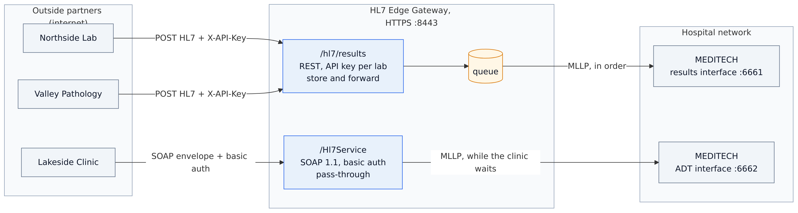
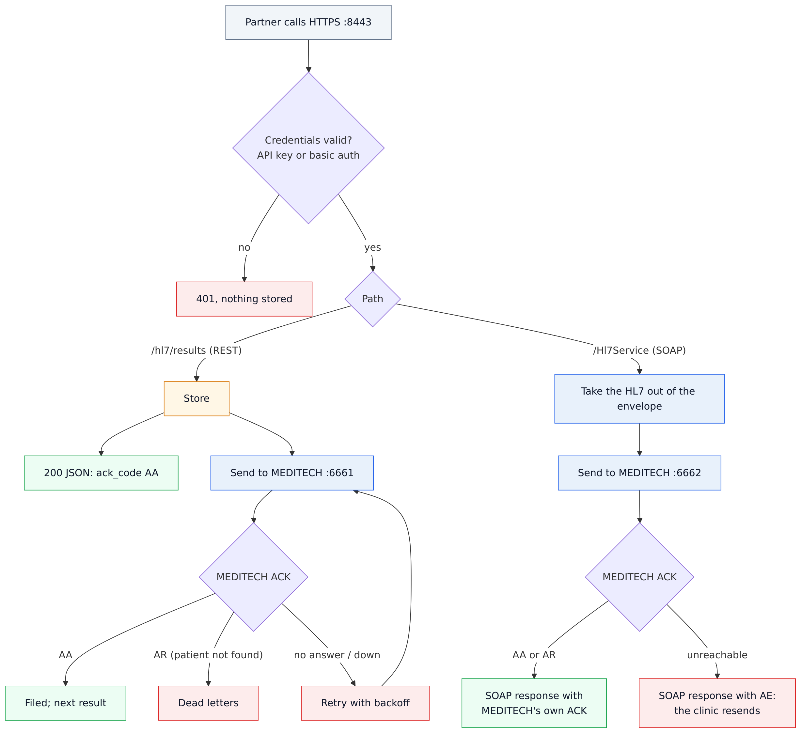
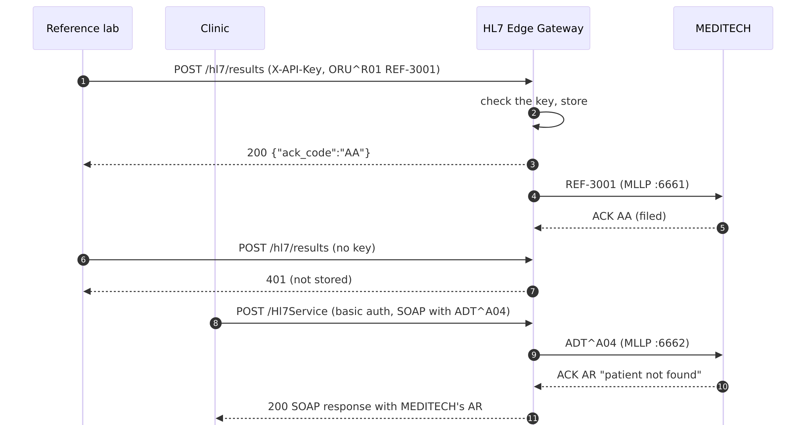

# 02 · Partners → MEDITECH (REST and SOAP over HTTPS)

Outside partners cannot open MLLP connections into the hospital, but they can call a web service.
HL7 Edge Gateway gives them HTTPS endpoints and delivers what they send to MEDITECH over MLLP.

```
Northside Lab   ──POST /hl7/results (REST, API key)──▶ ┌──────────────────────┐ ──MLLP :6661──▶ ┌──────────┐
Valley Pathology──POST /hl7/results (REST, API key)──▶ │   HL7 Edge Gateway   │   (results)     │ MEDITECH │
Lakeside Clinic ──POST /Hl7Service  (SOAP, basic)  ──▶ │   HTTPS :8443        │ ──MLLP :6662──▶ │          │
                                                       │   console :8080      │   (ADT)         └──────────┘
                                                       └──────────────────────┘
```

| Route | Source | Mode | What the partner gets back |
|---|---|---|---|
| `reference-lab-results` | REST `POST /hl7/results`, one API key per lab, ACK as JSON | store and forward | `200` with `"ack_code": "AA"` as soon as the result is stored. The gateway delivers to MEDITECH in order and retries while MEDITECH is down. If MEDITECH rejects a result (`AR`), it goes to dead letters. |
| `clinic-registrations` | SOAP 1.1 `POST /Hl7Service`, basic auth | pass-through | MEDITECH's own ACK inside the SOAP response: `AA`, or `AR` with MEDITECH's reason. If MEDITECH cannot be reached, the gateway answers `AE` and the clinic resends. |

Both routes share port 8443 and are told apart by their path.

Step-by-step guide with screenshots: <https://docs.lambogenius.com/hl7-edge-gateway/example-partners-to-meditech>

## Diagrams

**Architecture.** What runs where, and how the systems connect.



**Data flow.** What happens to a message at each step, including the failure paths.



**Sequence.** One run of the sample, message by message.



The Mermaid sources are in [diagrams/](diagrams). After editing one, re-export the PNGs with
`../render-diagrams.sh 02-partners-to-meditech`.

## Files

| File | What it is |
|---|---|
| `gateway.toml` | The gateway configuration |
| `compose.yaml` | Creates a test certificate, then starts the gateway and a stand-in MEDITECH |
| `meditech/receiver.py` | Stand-in for MEDITECH's inbound MLLP interfaces. Answers `AR "patient not found"` unless the patient ID is between 100101 and 100199 |
| `messages/` | Four lab results, a result for an unknown patient, and two SOAP registration requests |
| `.env.example` | License, admin token, the partners' API keys and the clinic's password; copy it to `.env` |
| `demo.sh`, `demo.ps1` | Runs every step below and checks the result |

## Run it

You need Docker, the gateway image, and a license. See [the prerequisites](../README.md#prerequisites).

```sh
cp .env.example .env          # then put your license in LAMBOGENIUS_LICENSE
docker compose up -d
```

The first start creates a test CA and a server certificate for `localhost` in `./certs`. The console is at
<http://localhost:8080>.

The commands below are for a Linux or macOS shell. On Windows, use `curl.exe` and add `--ssl-no-revoke`:
Windows' TLS library cannot check revocation for a test CA. Or run `./demo.ps1`.

**1. A reference lab posts a result.**

```sh
curl --cacert certs/ca.crt \
  -H "X-API-Key: northside-sample-key-4f8a2c" \
  -H "Content-Type: x-application/hl7-v2+er7" \
  --data-binary @messages/oru-r01-ref-1.hl7 \
  https://localhost:8443/hl7/results
```

```json
{"ack_code":"AA","control_id":"REF-3001","text":"","ack":"MSH|^~\\&|MEDITECH|...\rMSA|AA|REF-3001\r"}
```

`docker compose logs meditech` shows `AA REF-3001 … (filed)`. With a wrong or missing key, the gateway answers
`401`, and the message never reaches the queue.

**2. The clinic registers a patient over SOAP.**

```sh
curl --cacert certs/ca.crt -u lakeside-clinic:clinic-sample-password \
  -H 'Content-Type: text/xml; charset=utf-8' \
  -H 'SOAPAction: "urn:lakeside-clinic:hl7/SubmitHL7"' \
  --data-binary @messages/soap-adt-a04.xml \
  https://localhost:8443/Hl7Service
```

The response is a `<SubmitHL7Response>` with MEDITECH's ACK in `<ack>`: `MSA|AA|CLN-4001|filed`.
`soap-adt-a04-unknown-patient.xml` gets `MSA|AR|CLN-4099|patient not found: 555002`, straight from MEDITECH.

**3. MEDITECH goes down.**

```sh
docker compose stop meditech
```

Post `oru-r01-ref-3.hl7` and `oru-r01-ref-4.hl7` as in step 1. Both still get `200 AA`: they are queued.
In the console, `reference-lab-results` shows two queued and MEDITECH's connection error. A SOAP
registration sent now gets `AE`, because pass-through stores nothing.

**4. MEDITECH comes back.**

```sh
docker compose start meditech
```

Within 30 seconds, REF-3003 and then REF-3004 are filed, in order.

**5. A result for a patient MEDITECH does not know.**

Post `oru-r01-ref-unknown-patient.hl7`. The lab gets `200 AA` (the result is stored). MEDITECH then
answers `AR`, so the gateway moves REF-3099 to dead letters instead of retrying. Open
`reference-lab-results` → **Dead letters** in the console to see the message and MEDITECH's reason.

**Clean up:** `docker compose down -v`.

## Adapting it to your site

- **Your certificate.** Replace `certs/gateway.crt` and `certs/gateway.key` with a certificate partners
  trust, for the name they connect to. Every route on port 8443 must use the same `tls` settings.
- **Your MEDITECH.** Set each destination's `address` to the MEDITECH interface host and port. For
  MLLPS, add `tls = { ca = "/etc/hl7-edge-gateway/certs/meditech-ca.pem" }`.
- **Partners and keys.** Add one entry per partner under `keys`, each with a long random value from
  `.env`. The key's name is the caller in the logs. To see it on every stored message, set
  `RUST_LOG=info,hl7_edge_gateway=debug`:
  `http{route=reference-lab-results … caller="valley-pathology"}: stored seq=6`.
  Also restrict partners to their address ranges with `allow_from = ["203.0.113.0/24"]`.
- **Stronger caller authentication.** Instead of API keys, use mutual TLS (`tls.client_ca`) or OAuth2
  access tokens from your identity provider (`auth = { type = "jwt", … }`; see
  [sample 04](../04-entra-id-and-salesforce)).
- **The SOAP contract.** By default the gateway reads the HL7 text from the first element in the body
  whose text starts with `MSH` (here `<SubmitHL7><message>`). It answers with
  `<{operation}Response><ack>`, in the request's namespace. If your partner's WSDL
  says otherwise, use `soap = { message_element = "…", response_template = "…" }`. For SOAP 1.2, use
  `soap = { version = "1.2" }`.
