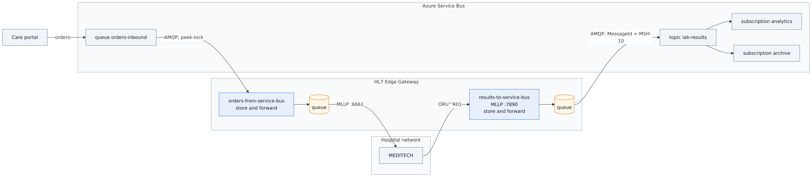
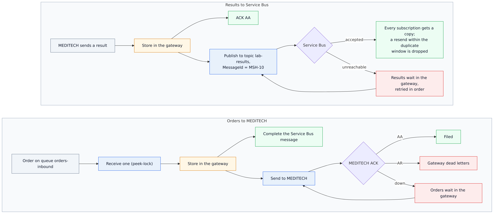
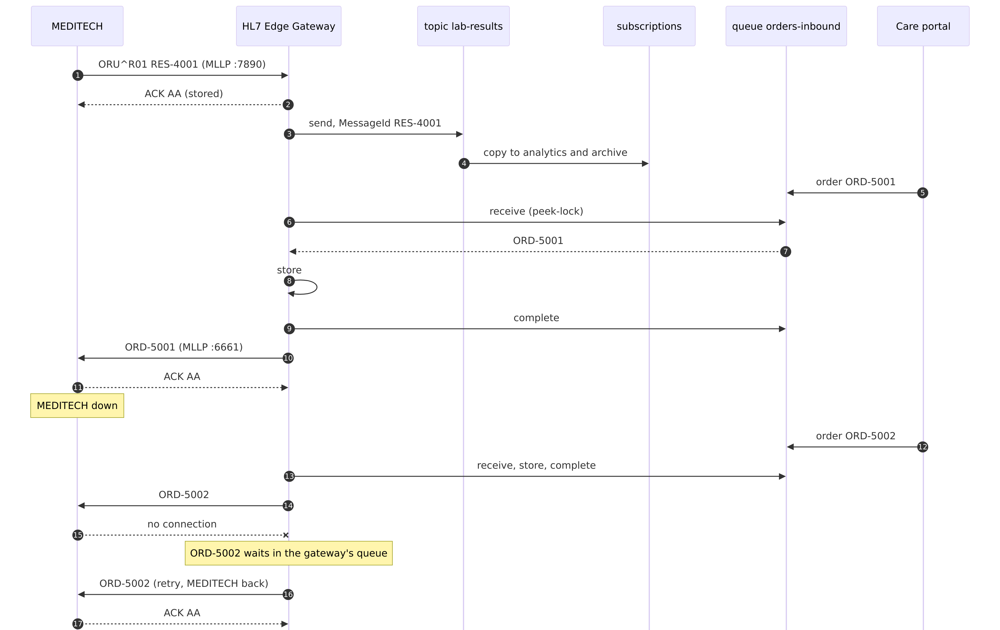

# 03 · MEDITECH ⇄ Azure Service Bus

Cloud applications rarely speak MLLP, but most can use a message broker. HL7 Edge Gateway connects
MEDITECH to Azure Service Bus in both directions, with the gateway's queue in between so that neither
side has to be up at the same time as the other.

```
                                    ┌──────────────────────┐            ┌─ Azure Service Bus ────────────────┐
MEDITECH ──MLLP :7890 (results)──▶  │                      │ ──AMQP──▶  │ topic lab-results                  │
                                    │   HL7 Edge Gateway   │            │   ├─ subscription analytics        │
                                    │   console :8080      │            │   └─ subscription archive          │
MEDITECH ◀──MLLP :6661 (orders)───  │                      │ ◀──AMQP──  │ queue orders-inbound ◀─ care portal│
                                    └──────────────────────┘            └────────────────────────────────────┘
```

| Route | From → to | What happens |
|---|---|---|
| `results-to-service-bus` | MLLP → topic `lab-results` | MEDITECH gets `AA` as soon as the result is stored. The gateway publishes in order. Each subscription receives its own copy. If Service Bus is unreachable, results wait in the gateway and are published once it is back. |
| `orders-from-service-bus` | queue `orders-inbound` → MLLP | The gateway takes each order off the queue, stores it, completes the Service Bus message, and sends the order to MEDITECH. If MEDITECH is down, orders wait in the gateway. If MEDITECH rejects an order (`AR`), it goes to the gateway's dead letters. |

The sample runs against the **Service Bus emulator** on your machine, so it needs no Azure subscription.
[Running against Azure](#running-against-azure) shows the changes for a real namespace.

Step-by-step guide with screenshots: <https://docs.lambogenius.com/hl7-edge-gateway/example-azure-service-bus>

## Diagrams

**Architecture.** What runs where, and how the systems connect.



**Data flow.** What happens to a message at each step, including the failure paths.



**Sequence.** One run of the sample, message by message.



The Mermaid sources are in [diagrams/](diagrams). After editing one, re-export the PNGs with
`../render-diagrams.sh 03-azure-service-bus`.

## Files

| File | What it is |
|---|---|
| `gateway.toml` | The gateway configuration |
| `compose.yaml` | The gateway, a stand-in MEDITECH, the Service Bus emulator and its SQL Server, plus two tools: `send` (MLLP) and `sb` (Service Bus) |
| `emulator/Config.json` | The emulator's entities: topic `lab-results` with two subscriptions, and queue `orders-inbound`, both with duplicate detection |
| `sb-tool/` | A small Python program (Azure SDK) that plays the cloud side: sends orders, and receives from subscriptions and dead-letter queues |
| `meditech/receiver.py` | Stand-in for MEDITECH's inbound orders interface. Answers `AR "patient not found"` unless the patient ID is between 100101 and 100199 |
| `messages/` | Three lab results and four orders, one of them for an unknown patient |
| `.env.example` | License, admin token, and the emulator's connection string; copy it to `.env` |
| `demo.sh`, `demo.ps1` | Runs every step below and checks the result |

## Run it

You need Docker (give it at least 4 GB of memory: the emulator uses SQL Server), the gateway image, and a
license. See [the prerequisites](../README.md#prerequisites).

```sh
cp .env.example .env          # then put your license in LAMBOGENIUS_LICENSE
docker compose --profile tools build sb
docker compose up -d
docker compose logs -f servicebus     # wait for "Emulator Service is Successfully Up!", then Ctrl+C
```

Starting the emulator takes a minute or two. Until it is up, the gateway logs
`Service Bus connection failed, retrying`, which is expected. It connects on its own once the emulator is
ready (`connected to sb://servicebus/orders-inbound`). The console is at <http://localhost:8080>.

**1. MEDITECH sends results; both subscriptions get them.**

```sh
docker compose run --rm send --to gateway:7890 /messages/oru-r01-1.hl7 /messages/oru-r01-2.hl7
docker compose run --rm sb receive lab-results analytics
docker compose run --rm sb receive lab-results archive
```

Each subscription prints both results. Every message has its MSH-10 as the Service Bus `MessageId`, and the
gateway's application properties:

```
lab-results/subscriptions/analytics: #1
  message_id=RES-5001  content_type=x-application/hl7-v2+er7
  properties: hl7_message_type=ORU^R01, hl7_processing_id=T, hl7_route=results-to-service-bus, hl7_sending_application=MEDITECH, hl7_sending_facility=GENERAL_HOSPITAL
    MSH|^~\&|MEDITECH|GENERAL_HOSPITAL|CLOUD|AZURE|20261019120100||ORU^R01^ORU_R01|RES-5001|T|2.5.1
    ...
```

Subscribers can filter on these properties. For example, a SQL filter `hl7_message_type = 'ORU^R01'` on a
subscription receives only results.

**2. A cloud application sends orders; MEDITECH files them.**

```sh
docker compose run --rm sb send orders-inbound /messages/orm-o01-1.hl7 /messages/orm-o01-2.hl7 /messages/orm-o01-unknown-patient.hl7
docker compose logs meditech
```

ORD-6001 and ORD-6002 are filed (`AA`). ORD-6099 is for a patient MEDITECH does not know, so it answers
`AR`. In the console, `orders-from-service-bus` shows one dead letter. **Dead letters → View** shows the order
and MEDITECH's reason.

**3. MEDITECH goes down.**

```sh
docker compose stop meditech
docker compose run --rm sb send orders-inbound /messages/orm-o01-3.hl7
```

The order leaves Service Bus at once (it is completed after the gateway stores it) and waits in the
gateway: one queued and retrying. Then run `docker compose start meditech`, and ORD-6003 is filed within
30 seconds.

**4. Service Bus becomes unreachable.**

```sh
docker compose stop servicebus
docker compose run --rm send --to gateway:7890 /messages/oru-r01-3.hl7
```

MEDITECH still gets `AA`. `results-to-service-bus` shows one queued, with the connection error. Then run
`docker compose start servicebus`. Once the emulator is up again (a minute), RES-5003 is published:
`docker compose run --rm sb receive lab-results analytics`.

**Clean up:** `docker compose down -v`.

## Pass-through or store-and-forward?

Both routes use store-and-forward, which is the right choice when the other side can be down for longer
than a few seconds.

A route from Service Bus can also be `passthrough`. The gateway then settles each Service Bus message by
MEDITECH's answer:
- `AA` completes it.
- `AR` dead-letters it in Service Bus, with reason `HL7 AR` and MEDITECH's text as the description.
- No answer abandons it, so Service Bus redelivers it.

Nothing is stored in the gateway, but a MEDITECH outage now uses up the queue's `MaxDeliveryCount`. With
this sample's settings (5), an order lands in the Service Bus dead-letter queue after about 20 seconds of
outage. Use pass-through only if the cloud side should own failed messages and MEDITECH outages are rare
and short.

## Running against Azure

**1. Create the entities** (Azure CLI). Duplicate detection needs the Standard tier or above:

```sh
az group create -n rg-hl7edge -l eastus
az servicebus namespace create -g rg-hl7edge -n contoso-hl7 --sku Standard
az servicebus topic create -g rg-hl7edge --namespace-name contoso-hl7 -n lab-results --enable-duplicate-detection true
az servicebus topic subscription create -g rg-hl7edge --namespace-name contoso-hl7 --topic-name lab-results -n analytics
az servicebus topic subscription create -g rg-hl7edge --namespace-name contoso-hl7 --topic-name lab-results -n archive
az servicebus queue create -g rg-hl7edge --namespace-name contoso-hl7 -n orders-inbound --enable-duplicate-detection true --max-delivery-count 5
```

**2. Choose how the gateway signs in.**

With a **shared access key**, the quickest option: create a policy with *Send* and *Listen*, and put
its connection string in `.env`. `gateway.toml` stays as it is.

```sh
az servicebus namespace authorization-rule create -g rg-hl7edge --namespace-name contoso-hl7 -n hl7-edge-gateway --rights Send Listen
az servicebus namespace authorization-rule keys list -g rg-hl7edge --namespace-name contoso-hl7 -n hl7-edge-gateway --query primaryConnectionString -o tsv
```

With **Entra ID** (recommended: no shared keys), give the gateway's identity the data roles, and use
`namespace` + `auth` instead of `connection_string`:

```sh
NS=$(az servicebus namespace show -g rg-hl7edge -n contoso-hl7 --query id -o tsv)
az role assignment create --assignee <app-or-identity-id> --role "Azure Service Bus Data Sender"   --scope "$NS/topics/lab-results"
az role assignment create --assignee <app-or-identity-id> --role "Azure Service Bus Data Receiver" --scope "$NS/queues/orders-inbound"
```

```toml
[route.destination]
type = "service_bus"
namespace = "contoso-hl7.servicebus.windows.net"
topic = "lab-results"
# On-premises: an app registration with a client secret.
auth = { type = "client_secret", tenant_id = "${AZURE_TENANT_ID}", client_id = "${AZURE_CLIENT_ID}", client_secret = "${AZURE_CLIENT_SECRET}" }
# On an Azure VM, App Service or Container App: auth = { type = "managed_identity" }
# On AKS with workload identity:               auth = { type = "workload_identity" }
```

**3. Firewalls.** AMQP uses port 5671 outbound. If the hospital network only allows HTTPS out, add
`transport = "websockets"` to the source and destination: the gateway then uses AMQP over WebSockets on
port 443.

**4. Send the test orders** with the `sb` tool pointed at Azure (the policy needs *Send*), or with
**Service Bus Explorer** in the Azure portal:

```sh
docker compose run --rm -e SERVICE_BUS_CONNECTION_STRING='Endpoint=sb://contoso-hl7.servicebus.windows.net/;SharedAccessKeyName=…;SharedAccessKey=…'   sb send orders-inbound /messages/orm-o01-1.hl7
```

**5. Clean up:** `az group delete -n rg-hl7edge`.
