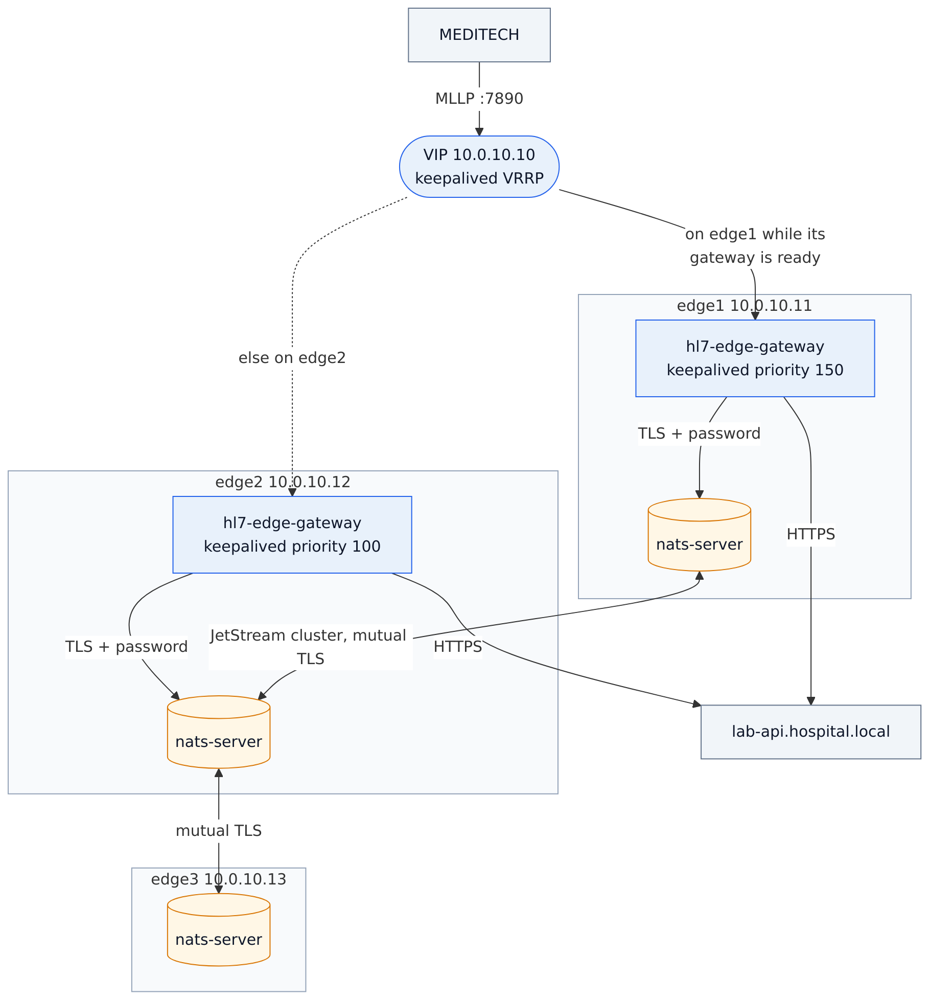
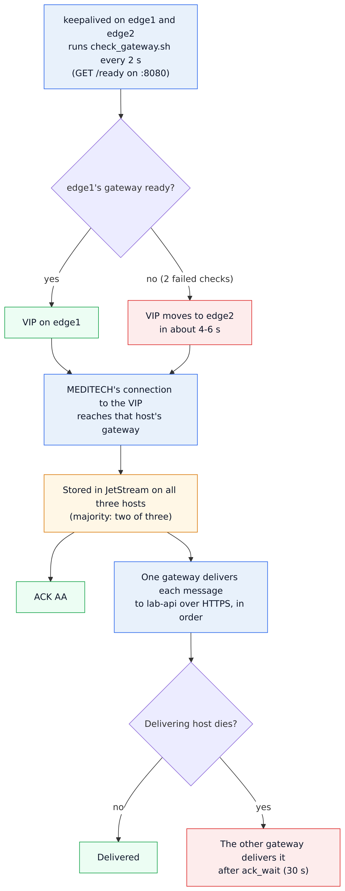
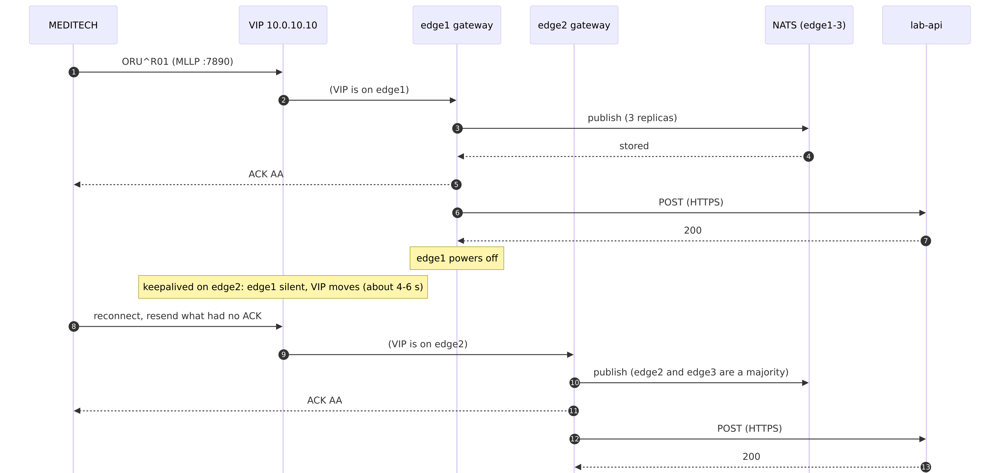

# 06 · On-premises high availability (Linux VMs, systemd, keepalived)

The production version of [sample 05](../05-high-availability) for a hospital data center: three Linux
VMs (or physical servers), NATS JetStream on all three, the gateway on two of them, and a virtual IP
address that MEDITECH connects to. Everything stays on the hospital network.

```
                          VIP 10.0.10.10  (keepalived: on edge1 while its gateway is ready, else edge2)
                                │
MEDITECH ──MLLP :7890──────────▶│
                                ▼
┌──────────── edge1 10.0.10.11 ─┐ ┌──────────── edge2 10.0.10.12 ─┐ ┌── edge3 10.0.10.13 ─┐
│ hl7-edge-gateway   :7890 :8080│ │ hl7-edge-gateway   :7890 :8080│ │                     │
│ keepalived (priority 150)     │ │ keepalived (priority 100)     │ │                     │
│ nats-server        :4222 :6222│ │ nats-server        :4222 :6222│ │ nats-server   :4222 │
└───────────────────────────────┘ └───────────────────────────────┘ └─────────────────────┘
        └──────────── JetStream cluster: every queued message on all three hosts ───────────┘
                                         │
                                         ▼  HTTPS
                              lab-api.hospital.local
```

- **What can fail without losing a message:** any one host, including the one holding the VIP. With
  edge3 in the cluster, NATS keeps its majority (two of three) whichever host goes down.
- **Failover time:** keepalived moves the VIP in about 4 to 6 seconds (two failed health checks, 2 s
  apart). MEDITECH reconnects to the same address and resends what it did not get an ACK for. A message
  that was in flight on the failed host is delivered by the other gateway after `ack_wait` (30 s).
- **Security:**
  - The gateways connect to NATS over TLS with a password.
  - The NATS hosts authenticate each other with mutual TLS.
  - Plain MLLP stays on the VLAN; for MLLPS, see [sample 02](../02-partners-to-meditech).

Step-by-step guide with screenshots: <https://docs.lambogenius.com/hl7-edge-gateway/example-on-premises>

## Diagrams

**Architecture.** What runs where, and how the systems connect.



**Data flow.** What happens to a message at each step, including the failure paths.



**Sequence.** One run of the sample, message by message.



The Mermaid sources are in [diagrams/](diagrams). After editing one, re-export the PNGs with
`../render-diagrams.sh 06-on-premises`.

## Files

| File | Goes to | On |
|---|---|---|
| `certs/make-certs.sh` | Run once; writes a CA and one certificate per host | your workstation |
| `nats/nats-server.conf` | `/etc/nats/nats-server.conf` | edge1, edge2, edge3 |
| `nats/nats-server.service` | `/etc/systemd/system/` | edge1, edge2, edge3 |
| `gateway/hl7-edge-gateway.toml` | `/etc/hl7-edge-gateway/` | edge1, edge2 |
| `gateway/env.example` | `/etc/hl7-edge-gateway/env` (chmod 600) | edge1, edge2 |
| `gateway/hl7-edge-gateway.service` | `/etc/systemd/system/` | edge1, edge2 |
| `keepalived/keepalived-edge1.conf`, `-edge2.conf` | `/etc/keepalived/keepalived.conf` | edge1, edge2 |
| `keepalived/check_gateway.sh` | `/etc/keepalived/` (chmod 755, owned by root) | edge1, edge2 |
| `test/` | A Docker harness that runs all of the above on three simulated hosts | your workstation |

Replace the addresses (10.0.10.11–13, VIP 10.0.10.10) with yours in `nats-server.conf`,
`hl7-edge-gateway.toml`, the keepalived files, and `make-certs.sh`.

## Install

Before you start:
- three hosts on one subnet, running a current Linux (RHEL 9, Ubuntu 22.04/24.04, or Debian 12);
- a free address for the VIP;
- the firewall open between the hosts for TCP 4222 and 6222 (NATS) and VRRP (IP protocol 112);
- from MEDITECH to the VIP for TCP 7890;
- from your admin network to 8080.

**1. Certificates** (on your workstation): `./certs/make-certs.sh`, then copy `certs/edgeN/` to each host.

**2. NATS** (on edge1, edge2 and edge3). Download `nats-server` 2.15 (tested with 2.15.1) from
<https://github.com/nats-io/nats-server/releases>.

```sh
sudo useradd --system --home /var/lib/nats --shell /usr/sbin/nologin nats
sudo install -m 755 nats-server /usr/local/bin/
sudo install -d -o nats -m 700 /var/lib/nats
sudo install -d /etc/nats/certs
sudo cp nats-server.conf /etc/nats/
sudo cp edgeN/* /etc/nats/certs/
sudo chown -R nats /etc/nats/certs
printf 'NATS_SERVER_NAME=edgeN\nHL7EDGE_NATS_PASSWORD=<the same long random value on every host>\n' | sudo tee /etc/nats/env
sudo chmod 600 /etc/nats/env
sudo cp nats-server.service /etc/systemd/system/
sudo systemctl enable --now nats-server
```

Check it once all three are up: `curl -s localhost:8222/jsz | grep -A3 meta_cluster` shows a leader and
three peers.

**3. The gateway** (on edge1 and edge2). Download the Linux x86_64 archive from
<https://lambogenius.com/downloads>.

```sh
sudo useradd --system --home /var/lib/hl7-edge-gateway --shell /usr/sbin/nologin hl7edge
sudo install -m 755 hl7-edge-gateway /usr/local/bin/
sudo install -d -o hl7edge /var/lib/hl7-edge-gateway
sudo install -d /etc/hl7-edge-gateway
sudo cp hl7-edge-gateway.toml /etc/hl7-edge-gateway/
sudo cp ca.crt /etc/hl7-edge-gateway/nats-ca.crt
sudo install -m 600 env.example /etc/hl7-edge-gateway/env
sudoedit /etc/hl7-edge-gateway/env     # HL7EDGE_NODE_ID=edge1 (or edge2), license, tokens, NATS password
sudo cp hl7-edge-gateway.service /etc/systemd/system/
sudo systemctl enable --now hl7-edge-gateway
curl -s localhost:8080/ready           # "ready" once it has connected to JetStream
```

**4. keepalived** (on edge1 and edge2):

```sh
sudo dnf install -y keepalived      # or: sudo apt install -y keepalived
sudo cp keepalived-edge1.conf /etc/keepalived/keepalived.conf     # keepalived-edge2.conf on edge2
sudo install -m 755 check_gateway.sh /etc/keepalived/
sudo systemctl enable --now keepalived
ip -brief address show eth0          # edge1 now also has 10.0.10.10
```

Set `interface` in the keepalived file to the host's interface name. Give the VRRP password
(`auth_pass`) your own value.

**5. Point MEDITECH** at `10.0.10.10:7890`, and open either console: `http://10.0.10.11:8080` or
`http://10.0.10.12:8080`.

## Test failover

| Test | Do | Expect |
|---|---|---|
| Gateway stops | `sudo systemctl stop hl7-edge-gateway` on edge1 | The VIP moves to edge2 within about 6 s (`journalctl -u keepalived`: `Entering MASTER STATE` on edge2). Messages keep flowing. |
| Host fails | Power off edge1 | The same, and NATS keeps working on edge2 and edge3. |
| NATS host fails | Power off edge3 | Nothing visible: JetStream still has two of three. |
| Recovery | Start edge1 again | The VIP moves back to edge1 once its gateway is ready (priority 150). |

The [`test/`](test) folder runs these tests automatically on three simulated hosts in Docker, using these
same files: `cd test && cp .env.example .env` (add your license), then `./run.sh`. It crashes edge1 (gateway,
NATS and keepalived at once), checks that the VIP moves and messages keep flowing, brings edge1 back, and
checks that the results arrived once each, in order, and that edge1's NATS has caught up.

## Operations

- **NATS version.** Use NATS Server 2.15.1 or later (these samples are tested with 2.15.1). In the same
  crash test with 2.11.17, the NATS server on the crashed host came back, logged `Detected orphaned
  stream`, and deleted its copies of the queue streams. It never got them back, so those streams were left
  with two replicas without any error. Check after any host restart:
  `curl -s 'localhost:8222/jsz?streams=true'` should list the same streams, with the same `last_seq`, on
  every host.
- **Upgrades:** one gateway host at a time. Stop the standby gateway first, upgrade it and start it; then
  the active one (the VIP moves while you do). NATS: one host at a time, waiting for
  `curl localhost:8222/healthz?js-enabled-only=true` to answer `ok` before going on to the next.
- **Backups:** the queue is transient: messages leave it once delivered. Back up the configuration, the
  certificates, and `/etc/*/env`. Disks for `/var/lib/nats` should be local and fast, not NFS.
- **Monitoring:**
  - `/metrics` on each gateway (`hl7edge_queue_depth`, `hl7edge_dead_letters`);
  - `localhost:8222/varz` and `/jsz` on each NATS host;
  - keepalived state changes in the journal.
- **Windows Server:** the gateway also runs as a Windows service
  (`hl7-edge-gateway service install --config C:\ProgramData\hl7-edge-gateway\hl7-edge-gateway.toml`).
  NATS has Windows builds. For the VIP, use your load balancer, because keepalived is Linux only.
