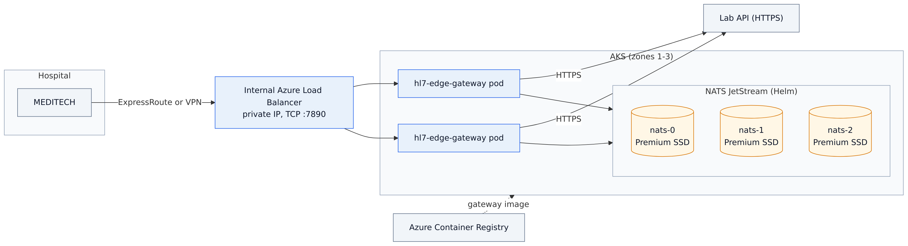
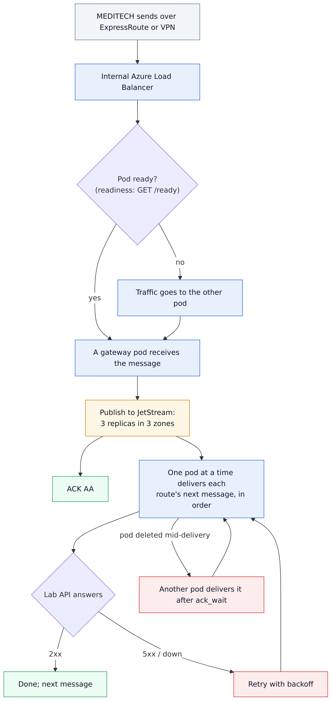
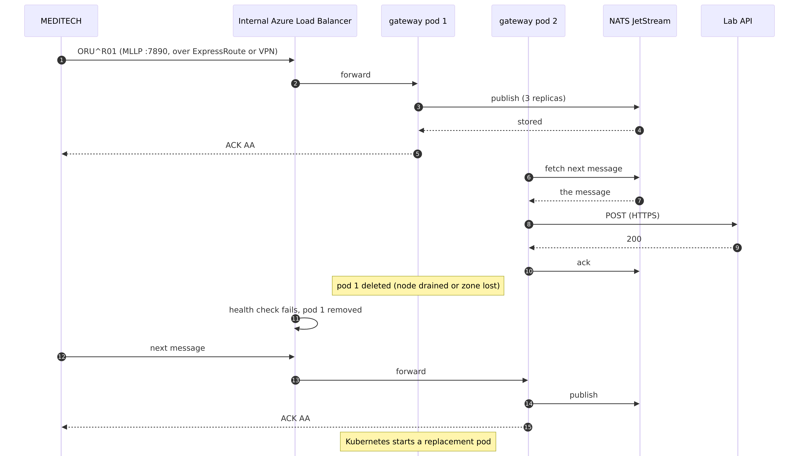

# 07 · Azure: high availability on AKS

HL7 Edge Gateway and NATS JetStream on Azure Kubernetes Service, across three availability zones.
MEDITECH reaches the gateway on a private IP address of an internal Azure Load Balancer, over ExpressRoute or
a site-to-site VPN.

```
Hospital ──ExpressRoute / VPN──▶ VNet ──▶ internal Azure Load Balancer 10.224.x.x:7890
                                               │
                         AKS (zones 1, 2, 3)   ▼
                         hl7-edge-gateway × 2  (zones spread)  ──HTTPS──▶ lab API
                         NATS JetStream × 3    (one per zone, Premium SSD)
                         images from Azure Container Registry
```

It uses the [shared Kubernetes base](../shared/kubernetes) and adds:
- `kustomization.yaml`: the internal load balancer (`azure-load-balancer-internal`), with
  `externalTrafficPolicy: Local` so the gateway sees MEDITECH's own address. It also points the image at
  your registry.
- `nats-azure.yaml`: zonal Premium SSD disks for JetStream (`managed-csi-premium`).
- `setup.sh` / `teardown.sh`: the cluster, the registry, the image, the secrets, NATS and the gateway, in one
  go.

Step-by-step guide with screenshots: <https://docs.lambogenius.com/hl7-edge-gateway/example-azure>

## Diagrams

**Architecture.** What runs where, and how the systems connect.



**Data flow.** What happens to a message at each step, including the failure paths.



**Sequence.** One run of the sample, message by message.



The Mermaid sources are in [diagrams/](diagrams). After editing one, re-export the PNGs with
`../render-diagrams.sh 07-azure-aks`.

## Before you start

- **Tools.** Azure CLI (`az login`), `kubectl`, `helm` 3, Docker.
- **The image.** The gateway image archive from <https://lambogenius.com/downloads>
  (`hl7-edge-gateway-0.3.0-docker-image-linux-amd64.tar.gz`), in this folder.
- **Region.** One with availability zones (most, for example `canadacentral`, `eastus2`, `westeurope`).
- **Cost.** About three `Standard_D2s_v5` nodes, three 20 GiB Premium SSD disks, a Standard registry and
  a load balancer. Run `./teardown.sh` when you are done.

## Deploy

```sh
cp .env.example .env      # region, names, license, tokens, your lab API URL
./setup.sh
```

`setup.sh` does the following, and prints MEDITECH's address at the end:
1. `az group create`, `az acr create`, and `az aks create` (3 nodes in zones 1–3, Azure CNI, managed
   identity, attached to the registry).
2. `docker load`, then pushes the image to `<registry>.azurecr.io/hl7-edge-gateway:0.3.0`.
3. Creates the namespace `hl7edge` and the Secret `hl7edge-secrets` from `.env`.
4. `helm upgrade --install nats nats/nats --version 2.15.1 -f ../shared/kubernetes/nats-values.yaml -f nats-azure.yaml`.
5. `kubectl apply -k .`, then waits for the load balancer's private IP.

## Check it

```sh
kubectl -n hl7edge get pods -o wide             # 2 gateway pods and 3 NATS pods, on different nodes and zones
kubectl -n hl7edge get svc hl7edge-mllp         # EXTERNAL-IP is a private address in the VNet
kubectl -n hl7edge port-forward svc/hl7edge-admin 8080      # console at http://localhost:8080
```

From a VM in the VNet (or from the hospital), send a test message with the gateway's own client:
`hl7-edge-gateway send --to <private-ip>:7890 oru-r01.hl7`.

**Failover test:**
1. Delete one gateway pod: `kubectl -n hl7edge delete pod <name>`. Messages keep flowing, and Kubernetes
   starts a new pod.
2. Delete a NATS pod (`nats-1`): nothing is lost.
3. For a zone failure, cordon and drain the nodes of one zone.

## Production notes

- **Private connectivity.** Peer the AKS VNet with the hub that has ExpressRoute or the VPN gateway. To pin
  the address MEDITECH uses, set `azure-load-balancer-ipv4` (and `-internal-subnet`) in
  `kustomization.yaml`.
- **Secrets.** Rather than `.env`, keep them in Key Vault and sync them with the Secrets Store CSI driver
  (`az aks enable-addons --addons azure-keyvault-secrets-provider`).
- **MLLPS.** Put the certificate in a Secret, and add `tls` to the source in `hl7-edge-gateway.toml`. Mount
  the Secret into the pods.
- **Entra ID.** Routes that call Entra ID-protected APIs, or Service Bus, can use AKS workload identity
  (`auth = { type = "workload_identity" }`). See samples [03](../03-azure-service-bus) and
  [04](../04-entra-id-and-salesforce).
- **Monitoring.** Enable Container Insights or Managed Prometheus. The pods have `prometheus.io/scrape`
  annotations; alert on `hl7edge_queue_depth` and `hl7edge_dead_letters`.

## What was tested

The Kubernetes manifests and NATS values are the [shared base](../shared/kubernetes), tested on k3s with
pod failures. This folder's kustomization renders with `kubectl kustomize`. **`setup.sh` has not been run
against a real Azure subscription yet**, so do a trial deployment in a test subscription first.

**Clean up:** `./teardown.sh` deletes the whole resource group.
