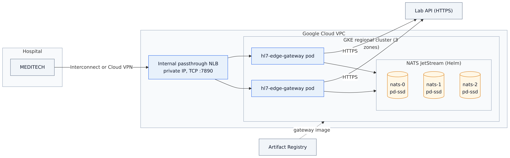
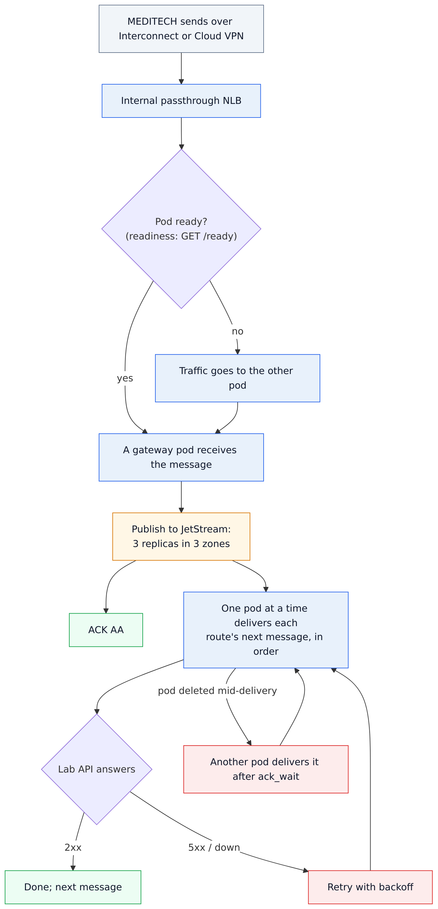
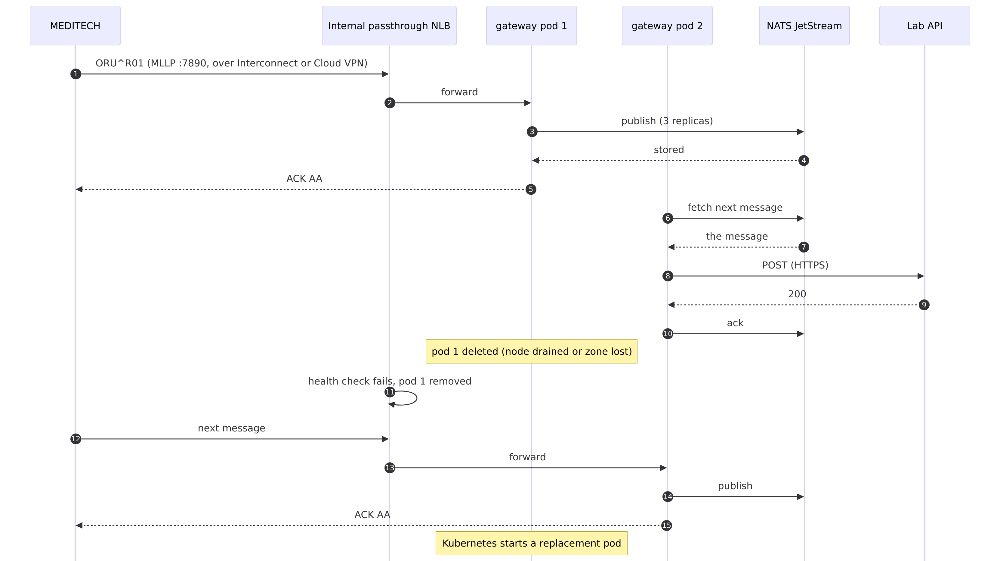

# 09 · Google Cloud: high availability on GKE

HL7 Edge Gateway and NATS JetStream on a regional GKE cluster, with nodes in three zones. MEDITECH reaches the
gateway through an internal passthrough Network Load Balancer, over Cloud Interconnect or Cloud VPN.

```
Hospital ──Interconnect / Cloud VPN──▶ VPC ──▶ internal passthrough NLB (regional):7890
                                                    │
                          GKE regional cluster      ▼
                          hl7-edge-gateway × 2  (zones spread)  ──HTTPS──▶ lab API
                          NATS JetStream × 3    (one per zone, pd-ssd)
                          images from Artifact Registry
```

It uses the [shared Kubernetes base](../shared/kubernetes) and adds:
- `kustomization.yaml`: the internal load balancer (`networking.gke.io/load-balancer-type: Internal`, with
  global access), `externalTrafficPolicy: Local`, and the image from your Artifact Registry.
- `nats-gcp.yaml`: SSD persistent disks (`premium-rwo`) for JetStream.
- `setup.sh` / `teardown.sh`: everything, in one go.

Step-by-step guide with screenshots: <https://docs.lambogenius.com/hl7-edge-gateway/example-gcp>

## Diagrams

**Architecture.** What runs where, and how the systems connect.



**Data flow.** What happens to a message at each step, including the failure paths.



**Sequence.** One run of the sample, message by message.



The Mermaid sources are in [diagrams/](diagrams). After editing one, re-export the PNGs with
`../render-diagrams.sh 09-gcp-gke`.

## Before you start

- **Tools.** Google Cloud CLI (`gcloud auth login`), `kubectl` with `gke-gcloud-auth-plugin`, `helm` 3,
  Docker.
- **Project.** A project with billing enabled.
- **The image.** The gateway image archive from <https://lambogenius.com/downloads>, in this folder.
- **Cost.** Three `e2-standard-2` nodes (one per zone), three 20 GiB SSD persistent disks, an internal load
  balancer, and Artifact Registry storage. Run `./teardown.sh` when you are done.

## Deploy

```sh
cp .env.example .env      # project, region, license, tokens, your lab API URL
./setup.sh
```

`setup.sh` does the following, and prints MEDITECH's address at the end:
1. Enables the GKE and Artifact Registry APIs.
2. Creates the Docker repository `hl7edge`.
3. Creates the regional cluster: one node per zone, VPC-native, Workload Identity, Shielded nodes.
4. Pushes the image.
5. Creates the namespace and the Secret from `.env`.
6. Installs NATS with Helm, then `kubectl apply -k .`

## Check it

```sh
kubectl -n hl7edge get pods -o wide             # 2 gateway pods and 3 NATS pods, in different zones
kubectl -n hl7edge get svc hl7edge-mllp         # EXTERNAL-IP is a private VPC address
kubectl -n hl7edge port-forward svc/hl7edge-admin 8080      # console at http://localhost:8080
```

**Automated check:** `../shared/kubernetes/check.sh` checks that the NATS pods are in three zones, starts a
stand-in lab API and MEDITECH in the cluster, sends results through the Service and the internal load
balancer, and deletes a gateway pod and a NATS pod while sending more. Every result must arrive once, in
order. For this check, set `LAB_API_URL=http://lab-api:8000/hl7/results` in `.env` before `./setup.sh`.

**Failover test by hand:** delete a gateway pod, then a NATS pod (`nats-1`). Messages keep flowing, and nothing is lost.

## Production notes

- **Address.** Reserve a static internal IP (`gcloud compute addresses create … --subnet … --addresses …`)
  and set it as the Service's `loadBalancerIP`, so MEDITECH's configuration never changes.
- **Who may connect.** Allow TCP 7890 from the hospital's ranges only, with a VPC firewall rule. Also use
  `allow_from` in the gateway.
- **Secrets.** Keep them in Secret Manager, with the Secret Manager add-on for GKE or the External Secrets
  Operator.
- **Monitoring.** Use Google Cloud Managed Service for Prometheus (a `PodMonitoring` on port 8080), and
  alert on `hl7edge_queue_depth` and `hl7edge_dead_letters`.

## What was tested

The Kubernetes manifests and NATS values are the [shared base](../shared/kubernetes), tested on k3s with
pod failures. On 2026-10-21, `setup.sh` ran in a real Google Cloud project (`northamerica-northeast1`,
gateway 0.5.1) in about 7 minutes, and `check.sh` passed:
- the 3 nodes, and the 3 NATS pods, were in zones a, b and c;
- results went through the Service and through the internal load balancer's private VPC address;
- with a gateway pod and then `nats-1` deleted, K8S-1 to K8S-4 arrived once each, in order.

`./teardown.sh` then deleted the cluster, its disks and load balancer, and the repository.

**On Windows:** `gcloud components install gke-gcloud-auth-plugin` may refuse to run without a terminal;
it prints the `copy-bundled-python` step that fixes this.

**Clean up:** `./teardown.sh` deletes the namespace (and the load balancer), the cluster and the repository.
