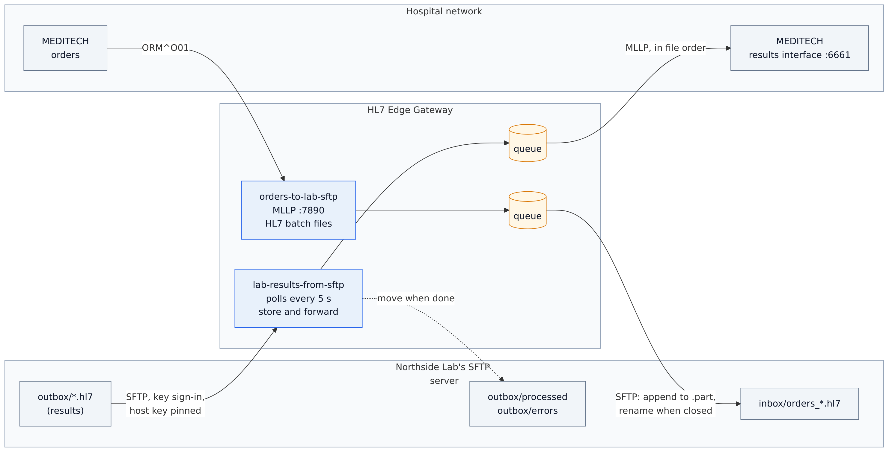
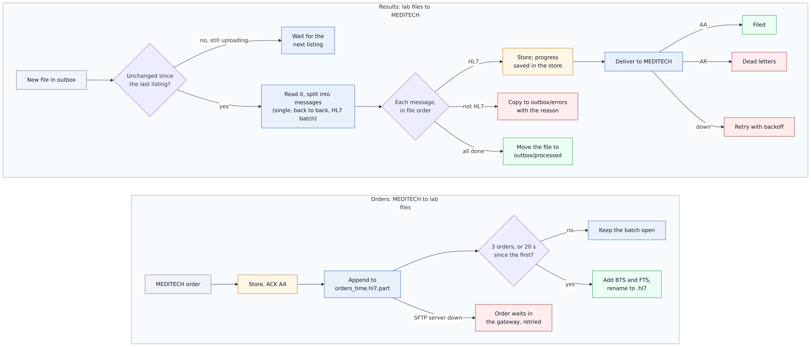
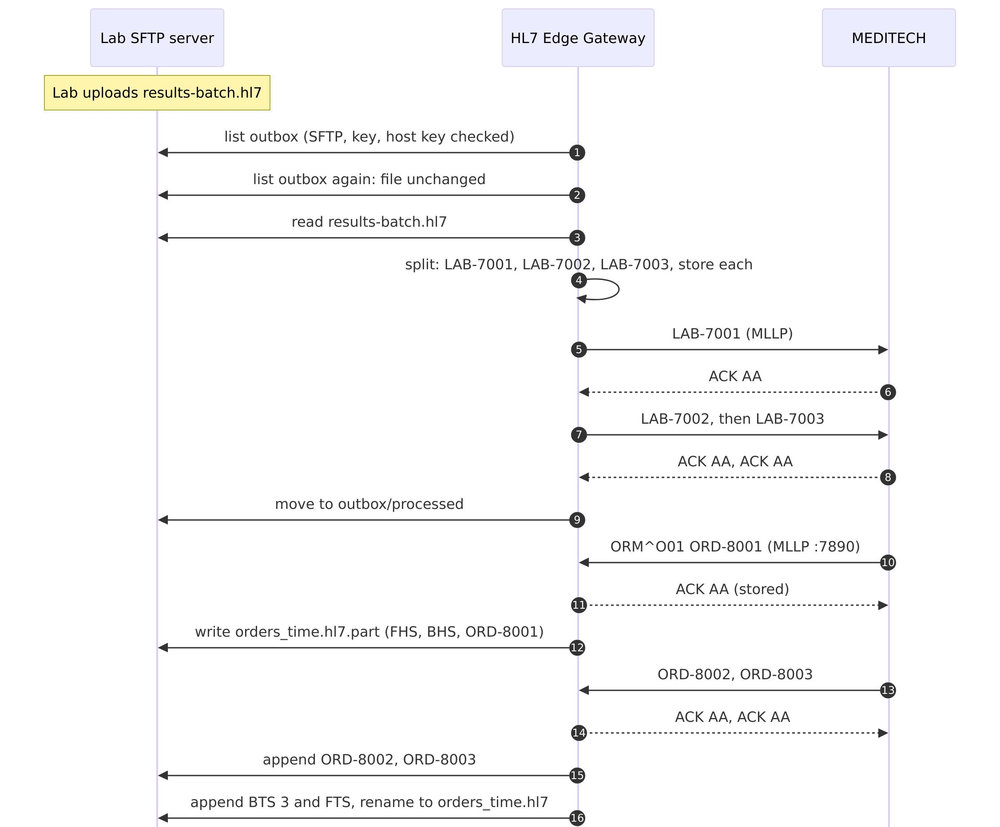

# 10 · HL7 files over SFTP (a reference lab ⇄ MEDITECH)

Many reference labs don't do MLLP or web services: they exchange HL7 **files** on an SFTP server. HL7 Edge
Gateway reads the lab's result files and hands each result to MEDITECH over MLLP, and writes MEDITECH's orders
to the lab as HL7 batch files.

```
                          ┌─ Northside Lab's SFTP server ─┐
                          │  outbox/   results (*.hl7)    │ ──SFTP (key)──▶ ┌──────────────────────┐ ──MLLP :6661──▶ MEDITECH
                          │    processed/  errors/        │                 │   HL7 Edge Gateway   │                (results)
                          │  inbox/    orders_*.hl7       │ ◀──SFTP (key)── │   console :8080      │ ◀──MLLP :7890── MEDITECH
                          └───────────────────────────────┘                 └──────────────────────┘                 (orders)
```

| Route | From → to | What happens |
|---|---|---|
| `lab-results-from-sftp` | SFTP `outbox/*.hl7` → MLLP | Every 5 s the gateway lists the folder. A file is read once it is unchanged between two listings, oldest first. It may be one result, results back to back, or an HL7 batch. Each result is stored, then delivered to MEDITECH in file order, and the file is moved to `outbox/processed`. Lines that are not HL7 go to `outbox/errors` with the reason; a result MEDITECH rejects (`AR`) goes to the gateway's dead letters. |
| `orders-to-lab-sftp` | MLLP → SFTP `inbox/` | MEDITECH gets `AA` once an order is stored. The gateway appends each order to an HL7 batch file (`orders_<time>.hl7.part`), and closes it (BTS with the count, FTS, then renamed to `.hl7`) after 3 orders, or 20 s after its first order. |

The gateway signs in with a **private key** and checks the server's **host key** against `known_hosts`: it
refuses to talk to any other server. The keys are made by the `keys` container on first start.

Step-by-step guide with screenshots: <https://docs.lambogenius.com/hl7-edge-gateway/example-sftp>

## Diagrams

**Architecture.** What runs where, and how the systems connect.



**Data flow.** What happens to a message at each step, including the failure paths.



**Sequence.** One run of the sample, message by message.



The Mermaid sources are in [diagrams/](diagrams). After editing one, re-export the PNGs with
`../render-diagrams.sh 10-sftp-files`.

## Files

| File | What it is |
|---|---|
| `gateway.toml` | The gateway configuration |
| `compose.yaml` | The lab's SFTP server (`atmoz/sftp`), a `keys` container that makes the SSH keys, the gateway, a stand-in MEDITECH, and two tools: `send` (MLLP) and `gateway-cli` |
| `sftp/make-keys.sh` | Makes the server's host keys, the gateway's key and its `known_hosts`, in the `keys` volume |
| `sftp/install-keys.sh` | Run by the SFTP server at startup: uses those host keys and lets the gateway's key in |
| `meditech/receiver.py` | Stand-in for MEDITECH's inbound results interface. Answers `AR "patient not found"` unless the patient ID is between 100101 and 100199 |
| `messages/` | An HL7 batch of three results (with CRLF line endings), a file with a stray line and an unknown patient, a single result, and five orders |
| `.env.example` | License, admin token, and your password on the SFTP server; copy it to `.env` |
| `demo.sh`, `demo.ps1` | Runs every step below and checks the result |

## Run it

You need Docker, the gateway image **0.4.0 or later**, and a license. See
[the prerequisites](../README.md#prerequisites).

```sh
cp .env.example .env          # then put your license in LAMBOGENIUS_LICENSE
docker compose up -d
docker compose logs keys      # the SFTP server's host key fingerprint
```

The console is at <http://localhost:8080>. To look at the lab's folders yourself, connect any SFTP client to
`localhost:2222` as `hospital` with `LAB_SFTP_PASSWORD` from `.env`. The steps below use `docker compose exec`
instead, so they need no client.

The lab drops a file the way SFTP uploads usually finish, under a temporary name that is then renamed. This
helper does that (for Linux and macOS shells; `demo.ps1` has the PowerShell version):

```sh
lab_drop() { docker compose exec -T sftp sh -c 'f=/home/hospital/outbox/$1; cat > "$f.tmp" && chown 1001:100 "$f.tmp" && mv "$f.tmp" "$f"' sh "$1" < "messages/$1"; }
```

**1. The lab drops an HL7 batch file with three results.**

```sh
lab_drop results-batch.hl7
docker compose logs meditech
```

Within about 10 seconds (two listings), MEDITECH files LAB-7001, LAB-7002 and LAB-7003, in that order, and
the file moves to `outbox/processed`. The batch's FHS, BHS, BTS and FTS segments are dropped, and its CRLF line
endings don't matter.

**2. A file with a stray line, and a result for a patient MEDITECH doesn't know.**

```sh
lab_drop results-mixed.hl7
docker compose exec sftp cat /home/hospital/outbox/errors/results-mixed.hl7.txt
```

```
message 2 (no MSH-10): message does not start with an MSH segment
```

LAB-7004 is filed. The stray line is rejected on its own, not glued onto LAB-7004, and copied to
`outbox/errors` with the reason. MEDITECH answers LAB-7005 with `AR`, so it goes to the route's dead letters in
the console, where you can look at it, requeue it once the patient exists, or delete it.

**3. MEDITECH sends orders; they reach the lab as HL7 batch files.**

```sh
docker compose run --rm send --to gateway:7890 /messages/orm-o01-1.hl7 /messages/orm-o01-2.hl7 /messages/orm-o01-3.hl7
docker compose exec sftp ls /home/hospital/inbox
```

The third order closes the batch: `orders_<time>.hl7` holds FHS, BHS, the three orders, `BTS|3` and `FTS|1`,
with CRLF line endings. While a batch is open it is `orders_<time>.hl7.part`, which the lab's system ignores.
Send `orm-o01-4.hl7` and its batch is closed 20 seconds later (`max_wait`), with `BTS|1`.

**4. MEDITECH goes down.** Stop it (`docker compose stop meditech`), and `lab_drop result-single.hl7`. The
gateway still takes the file (LAB-7006 is stored) and moves it to `processed`; the console shows
`lab-results-from-sftp` retrying. `docker compose start meditech`, and LAB-7006 is filed.

**5. The lab's SFTP server goes down.** `docker compose stop sftp`, then send `orm-o01-5.hl7`. MEDITECH still
gets `AA`; the order waits in the gateway, which retries. `docker compose start sftp`, and it reaches the inbox.

**6. The host key.** `docker compose run --rm gateway-cli host-key --to sftp` prints the fingerprint of the key
the server presents. It matches the one the `keys` container printed: the gateway would refuse a server with
any other key.

Or run all of it: `./demo.sh` (Linux, macOS, Git Bash) or `./demo.ps1` (PowerShell).

**Clean up:** `docker compose down -v` (`-v` also deletes the queue and the keys).

## Using your own SFTP server

- **Host key.** Get the server's fingerprint from its administrator, or read it with
  `hl7-edge-gateway host-key --to sftp.lab.example.org` and check it with them. Put it in the route as
  `host_key = "SHA256:…"`, or use a `known_hosts` file (the command prints the line for it).
- **Sign-in.** Make a key for the gateway (`ssh-keygen -t ed25519 -f gateway_ed25519`) and send the lab the
  `.pub` file. Point `private_key` at the private key, readable only by the gateway's user, or put it in an
  environment variable with `private_key_env`. A password (`password = "${LAB_SFTP_PASSWORD}"`) works too.
- **Folders.** `directory` is relative to the account's home folder unless it starts with `/`. The `processed`
  and `errors` folders must exist.
- **What the lab expects.** One message per file (`batch_format = "single"`, named `{control_id}.hl7`), messages
  back to back (`concatenated`), or HL7 batches (`hl7_batch`); line endings `cr`, `crlf` or `lf`; and the file
  name pattern.
- **More than one gateway.** With the JetStream store (sample 05), one node at a time polls the folder, and all
  nodes append to the same batch file. Nothing is read twice.
