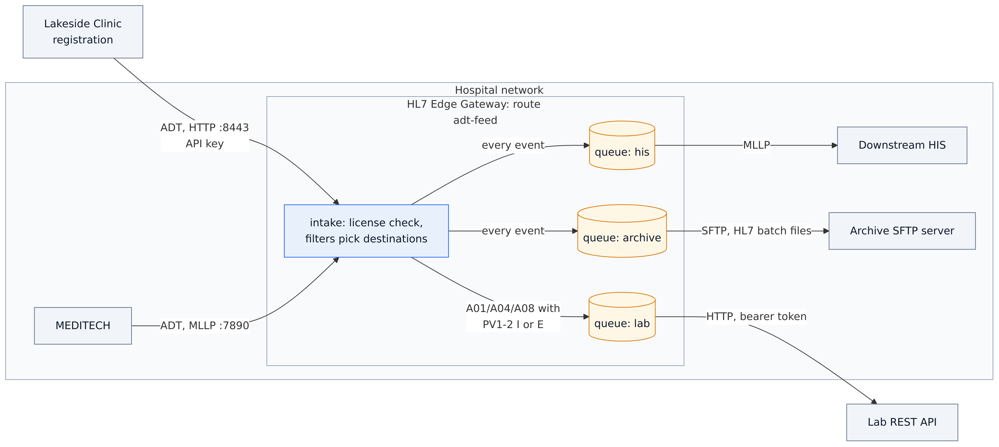
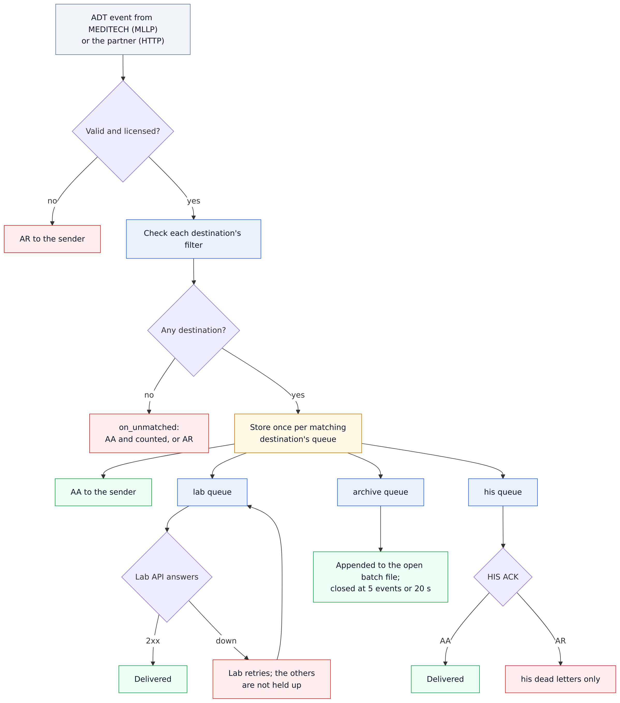
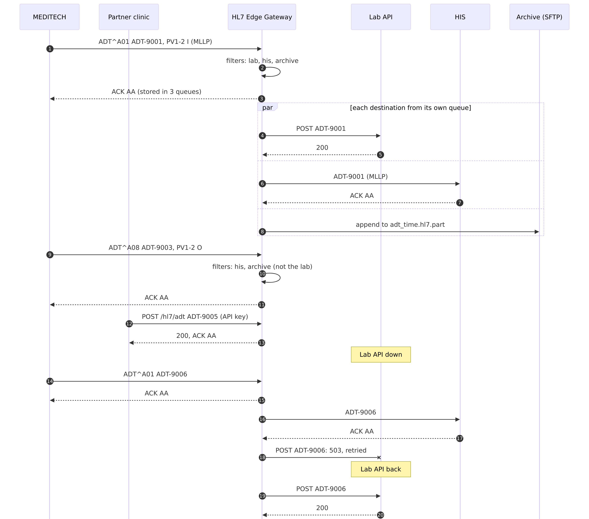

# 11 · One ADT feed to three systems (several sources and destinations)

A hospital's ADT events come from MEDITECH, and from a partner clinic's registration system. Three systems need
them: the lab wants inpatient and emergency admissions only, the downstream HIS wants everything, and an archive
keeps everything as files. With HL7 Edge Gateway 0.5 that is **one route with two sources and three destinations**.

```
MEDITECH ───────MLLP :7890──────▶ ┌──────────────────────────┐ ──HTTP, filtered──▶ lab API   (A01/A04/A08, PV1-2 I or E)
                                  │ route adt-feed           │
Lakeside Clinic ─HTTP :8443 ─────▶ │   one queue per          │ ──MLLP──────────────▶ HIS       (every event)
 (POST /hl7/adt, API key)         │   destination            │
                                  └──────────────────────────┘ ──SFTP, HL7 batches─▶ archive   (every event)
```

| Destination | Gets | Through |
|---|---|---|
| `lab` | ADT^A01, A04 and A08 for inpatients and emergency patients (`PV1-2` is `I` or `E`) | the lab's REST API, with a bearer token |
| `his` | every event | MLLP; a patient the HIS doesn't know (AR) goes to this destination's dead letters |
| `archive` | every event | SFTP, as HL7 batch files of up to 5 events, closed after 20 s at most |

Each destination has a **queue of its own**: when the lab API is down, the HIS and the archive keep getting
events, and the lab catches up when it is back. Both senders get `AA` once an event is stored for every
destination it goes to.

Step-by-step guide with screenshots: <https://docs.lambogenius.com/hl7-edge-gateway/example-one-feed-many-systems>

## Diagrams

**Architecture.** What runs where, and how the systems connect.



**Data flow.** What happens to a message at each step, including the failure paths.



**Sequence.** One run of the sample, message by message.



The Mermaid sources are in [diagrams/](diagrams). After editing one, re-export the PNGs with
`../render-diagrams.sh 11-one-feed-many-systems`.

## Files

| File | What it is |
|---|---|
| `gateway.toml` | The gateway configuration: one route, `sources` and `[[route.destinations]]` with a filter |
| `compose.yaml` | The gateway, the lab API (as in sample 01), the HIS, the archive's SFTP server and its keys (as in sample 10), and the `send` tool |
| `lab-api/app.py` | The lab's REST API; `POST /control/down` and `/control/up` switch an outage |
| `his/receiver.py` | The downstream HIS over MLLP; answers `AR` for a patient ID outside 100101–100199 |
| `sftp/` | Makes and installs the SFTP keys, as in sample 10 |
| `messages/` | Seven ADT events: an inpatient A01, an emergency A04, an outpatient A08, an A03 discharge, the partner's A04, an A01 sent during the lab outage, and an A08 for a patient the HIS doesn't know |
| `.env.example` | License, admin token, the lab API's token, the partner's API key and the SFTP password; copy it to `.env` |
| `demo.sh`, `demo.ps1` | Runs every step below and checks the result |

## Run it

You need Docker, the gateway image **0.5.0 or later**, and a license. See
[the prerequisites](../README.md#prerequisites).

```sh
cp .env.example .env          # then put your license in LAMBOGENIUS_LICENSE
docker compose up -d
```

The console is at <http://localhost:8080>: the route `adt-feed` shows its two sources, and a row for each of its
three destinations with its filter, state and queue.

**1. MEDITECH sends four ADT events.**

```sh
docker compose run --rm send --to gateway:7890 /messages/adt-a01-inpatient.hl7 /messages/adt-a04-emergency.hl7 \
  /messages/adt-a08-outpatient.hl7 /messages/adt-a03-discharge.hl7
docker compose logs his
curl http://localhost:8000/received
```

The HIS gets all four, in order. The lab gets ADT-9001 (an inpatient A01) and ADT-9002 (an emergency A04) only:
ADT-9003 is an outpatient (`PV1-2` = `O`), and ADT-9004 is an A03.

**2. The partner clinic posts an event over HTTP.**

```sh
curl -H "X-API-Key: <PARTNER_API_KEY from .env>" -H "Content-Type: x-application/hl7-v2+er7" \
  --data-binary @messages/adt-a04-partner.hl7 http://localhost:8443/hl7/adt
```

It answers with the HL7 ACK (`MSA|AA|ADT-9005`). ADT-9005 joins the same queues, after MEDITECH's events: the HIS
and the lab get it, and it is the fifth event in the archive's batch file, which closes it
(`docker compose exec sftp ls /home/hospital/inbox`).

**3. The lab API goes down.**

```sh
curl -X POST http://localhost:8000/control/down
docker compose run --rm send --to gateway:7890 /messages/adt-a01-during-outage.hl7
```

The HIS has ADT-9006 at once, and the archive too; it waits in the **lab's** queue only, and the console shows
the lab retrying while the other two are idle. `curl -X POST http://localhost:8000/control/up`, and the lab catches
up.

**4. A patient the HIS doesn't know.** Send `adt-a08-unknown-patient.hl7`. The HIS answers `AR`, so ADT-9007 goes
to the **HIS's** dead letters (the console: select the `his` row, then Dead letters). The lab and the archive get it
as usual. Once the patient exists in the HIS, requeue it there.

Or run all of it: `./demo.sh` (Linux, macOS, Git Bash) or `./demo.ps1` (PowerShell).

**Clean up:** `docker compose down -v`.

## The configuration, in short

```toml
[[route]]
name = "adt-feed"
mode = "store_and_forward"
sources = [
  { type = "mllp", listen = "0.0.0.0:7890" },
  { type = "http", listen = "0.0.0.0:8443", path = "/hl7/adt", auth = { type = "api_key", keys = { … } } },
]

[[route.destinations]]
name = "lab"
type = "http"
url = "http://lab-api:8000/hl7/admissions"
filter = { message_type = ["ADT^A01", "ADT^A04", "ADT^A08"], fields = { "PV1-2" = ["I", "E"] } }

[[route.destinations]]
name = "his"
type = "mllp"
address = "his:6661"
store_and_forward = { on_reject = "dead_letter" }

[[route.destinations]]
name = "archive"
type = "sftp"
# …
```

- **Filters.**
  - `message_type` matches MSH-9 by component: `ADT` is any ADT, and `ADT^A08` is that event.
  - The other MSH fields by name are `sending_application`, `sending_facility`, `receiving_application`,
    `receiving_facility` and `processing_id`.
  - `fields` takes segment field paths: `PV1-2`, `OBR-4.1`, `PID-3.4.1`. A path matches any occurrence of the
    segment and any repetition of the field.
  - The values of one field are alternatives (OR), and every field named must match (AND). `*` and `?` are
    wildcards.
  - `any = [ {…}, {…} ]` needs at least one of several conditions (OR across fields), and `not = {…}` excludes
    what matches it, for example `filter = { message_type = ["ADT"], not = { message_type = ["ADT^A03"] } }`.
  - A destination without a filter gets every event.
- **No match.** When no destination's filter matches an event, `on_unmatched` decides: `"accept"` (the default:
  AA, counted in the console) or `"reject"` (AR).
- **Per-destination settings.** `store_and_forward = { … }` on a destination replaces the route's retry and
  `on_reject` settings for that destination.
- **Pass-through routes** can have several destinations too. Mark one `primary = true`: it is delivered while the
  sender waits, and its answer is the ACK. The others get a copy of what it accepted, through their queues.
