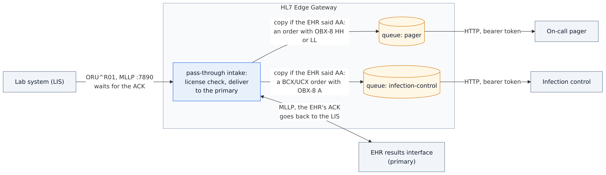
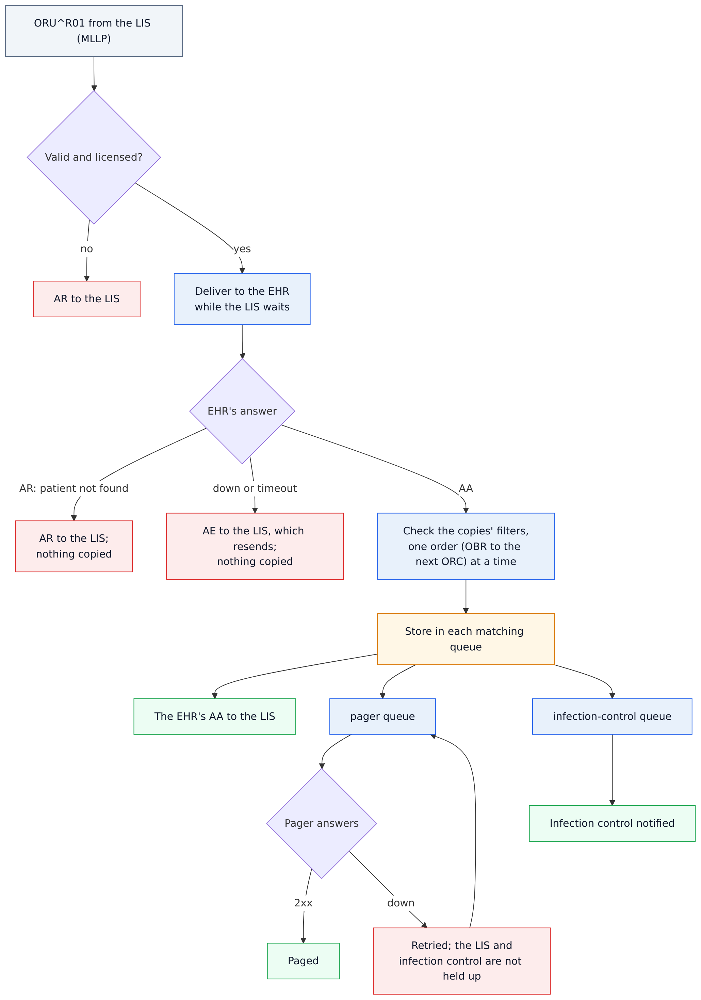
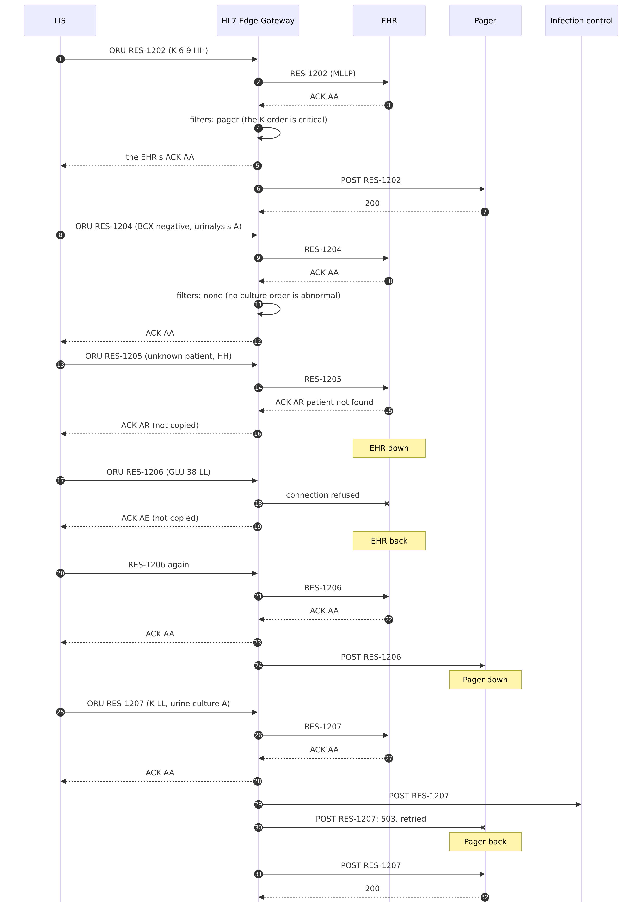

# 12 · Results to the EHR, alerts by order (pass-through and segment groups)

A lab system (LIS) sends results to the EHR and wants to know, at once, whether each one was filed. Two
teams also act on results: the on-call pager on critical values, and infection control on positive
cultures. With HL7 Edge Gateway 0.5 that is **one pass-through route**. The EHR is its `primary`
destination, so the LIS waits for the EHR's own ACK. The pager and infection control get **copies of what
the EHR accepted**, through queues of their own, picked by **segment-group filters**.

```
                                    ┌───────────────────────┐ ──MLLP, the LIS waits──▶ EHR (primary): its ACK goes back
LIS ─ORU^R01, MLLP :7890──────────▶ │ route results         │
     ◀────────── the EHR's ACK ──── │ (pass-through)        │ ──copy, HTTP──▶ pager              an order with OBX-8 HH or LL
                                    │                       │ ──copy, HTTP──▶ infection control  a BCX/UCX order with OBX-8 A
                                    └───────────────────────┘
```

| Destination | Gets | Why a group |
|---|---|---|
| `ehr` (primary) | every result, while the LIS waits; its ACK is the LIS's answer | — |
| `pager` | results with a critical value (`OBX-8` HH or LL), once the EHR filed them | the page names the order the critical value belongs to |
| `infection-control` | a culture order (`OBR-4.1` BCX or UCX) whose own result is abnormal (`OBX-8` A) | without it, a negative blood culture next to an abnormal urinalysis would match |

A **segment group** is a segment and the segments after it, up to the next one: here an OBR and its OBX,
ended early by the next order's `ORC` (`until = ["ORC"]`). The group's conditions must all hold in one
group, so `OBR-4.1 = BCX` and `OBX-8 = A` must belong to the same order.

What pass-through means here:

- The EHR answers **AR** (patient not found): the LIS gets that AR, and **nothing is copied**, so nobody is
  paged for a result that isn't in the chart.
- The EHR is **down**: the LIS gets **AE** and resends; nothing is copied until the EHR files it.
- The pager is **down**: the LIS isn't held up. The copy waits in the pager's queue and is retried, and
  infection control isn't held up either.

Step-by-step guide with screenshots: <https://docs.lambogenius.com/hl7-edge-gateway/example-results-to-ehr-and-alerts>

## Diagrams

**Architecture.** What runs where, and how the systems connect.



**Data flow.** What happens to a message at each step, including the failure paths.



**Sequence.** One run of the sample, message by message.



## What's here

| File | What it is |
|---|---|
| [`gateway.toml`](gateway.toml) | The route: an MLLP source, the EHR as primary, and the two filtered copies |
| [`compose.yaml`](compose.yaml) | The gateway, and stand-ins for the EHR, the pager and infection control |
| [`ehr/receiver.py`](ehr/receiver.py) | The EHR over MLLP: AA, or AR for a patient it doesn't know (it knows 100101–100199) |
| [`notify/app.py`](notify/app.py) | The pager and infection control (one stand-in, run twice): prints each order's flagged results; `POST /control/down` and `/control/up` switch an outage |
| [`messages/`](messages) | Seven ORU^R01 results, RES-1201 to RES-1207 |
| [`filters/`](filters) | The infection-control conditions without and with a group, for the `filter` command |
| `demo.sh`, `demo.ps1` | Run every step and check the result |

## Run it

You need Docker and the gateway image 0.5.0 or later (see the [top-level README](../README.md)).

```sh
cd 12-results-to-ehr-and-alerts
cp .env.example .env        # put your license in it
./demo.sh                   # or .\demo.ps1 in PowerShell
docker compose down -v      # when you are done
```

Or step by step:

**1. Start it.**

```sh
docker compose up -d
```

In the console at <http://localhost:8080>, the route `results` is pass-through, with `ehr` marked primary
("while the sender waits") and a row for each copy with its filter.

**2. The LIS sends four results.** `send` prints the ACK the LIS gets, which is the EHR's own:

```sh
docker compose run --rm send --to gateway:7890 /messages/oru-normal.hl7 /messages/oru-critical-potassium.hl7 \
  /messages/oru-positive-culture.hl7 /messages/oru-negative-culture-abnormal-urine.hl7
    1       2 ms  MSA|AA|RES-1201|filed
    2       1 ms  MSA|AA|RES-1202|filed
    3       1 ms  MSA|AA|RES-1203|filed
    4       1 ms  MSA|AA|RES-1204|filed

docker compose logs pager infection-control
pager-1              | pager: RES-1202 patient 100142: GLU: GLU 102 mg/dL H; K: K 6.9 mmol/L HH
infection-control-1  | infection-control: RES-1203 patient 100143: BCX: ORG STAAUR^Staphylococcus aureus A
```

RES-1202's potassium is critical (HH), so the pager gets it; its glucose is only high (H). RES-1203 is a
positive blood culture. RES-1201 is normal. RES-1204 has a blood culture with no growth (N) and an
abnormal urinalysis (A): no culture is positive, so infection control doesn't get it.

**3. See why, condition by condition.** The `filter` command checks a filter, or the whole configuration,
against messages. It sends nothing:

```sh
docker compose run --rm --entrypoint hl7-edge-gateway send \
  filter -f @/filters/positive-culture-flat.toml /messages/oru-negative-culture-abnormal-urine.hl7
RES-1204 ORU^R01  MATCH
  yes  OBR-4.1 BCX|UCX   found BCX, UA
  yes  OBX-8 A           found N, A, H

docker compose run --rm --entrypoint hl7-edge-gateway send \
  filter -f @/filters/positive-culture-group.toml /messages/oru-negative-culture-abnormal-urine.hl7
RES-1204 ORU^R01  NO MATCH
  no   group OBR until ORC: at least one where
    no   OBR #1
      yes  OBR-4.1 BCX|UCX   found BCX
      no   OBX-8 A           found N
    no   OBR #2
      no   OBR-4.1 BCX|UCX   found UA
      yes  OBX-8 A           found A, H
```

Without the group, each path is checked against the whole message, and BCX and A are both somewhere in it.
With the group, they must be in the same order. `filter -c /gateway.toml /messages/…` shows every
destination of the route; the console's **Filter tester** does the same for pasted messages.

**4. A critical result for a patient the EHR doesn't know.**

```sh
docker compose run --rm send --to gateway:7890 /messages/oru-critical-unknown-patient.hl7
    1       1 ms  MSA|AR|RES-1205|patient not found: 200512
```

The LIS gets the EHR's AR. RES-1205 matches the pager's filter, but it isn't copied: copies are made only
of what the primary accepted.

**5. The EHR is down.**

```sh
docker compose stop ehr
docker compose run --rm send --to gateway:7890 /messages/oru-critical-glucose.hl7
    1    4001 ms  MSA|AE|RES-1206|ehr:6661: connection failed: …
docker compose start ehr
docker compose run --rm send --to gateway:7890 /messages/oru-critical-glucose.hl7
    1       2 ms  MSA|AA|RES-1206|filed
```

The LIS gets AE and resends, as LIS interfaces do. Only the resend, once filed, is copied to the pager.

**6. The pager is down.**

```sh
curl -X POST http://localhost:8001/control/down
docker compose run --rm send --to gateway:7890 /messages/oru-critical-during-pager-outage.hl7
    1       2 ms  MSA|AA|RES-1207|filed
```

RES-1207 has a critical potassium and a positive urine culture. The LIS gets AA at once and infection
control gets its copy; the pager's copy waits in its queue (the console shows `pager` retrying).
`curl -X POST http://localhost:8001/control/up`, and the pager catches up.

## In production

- **The EHR's ACK timeout.** The LIS waits for the EHR, so set the LIS's ACK timeout above the gateway's
  `request_timeout` for the EHR (30 s by default).
- **TLS.** Use MLLPS and HTTPS (`tls = { … }`) on both sides; the gateway warns about plain MLLP and HTTP.
- **Flags.** OBX-8 values differ between labs (HH/LL, `>`/`<`, `A`/`AA`). List the ones your lab sends,
  and check the filters on real results with `hl7-edge-gateway filter -c` before going live.
- **Groups.** Group on the segment that starts each order in your messages: `OBR` with `until = ["ORC"]`
  when each order starts with an ORC, as here. See [Filters](https://docs.lambogenius.com/hl7-edge-gateway/filters).
