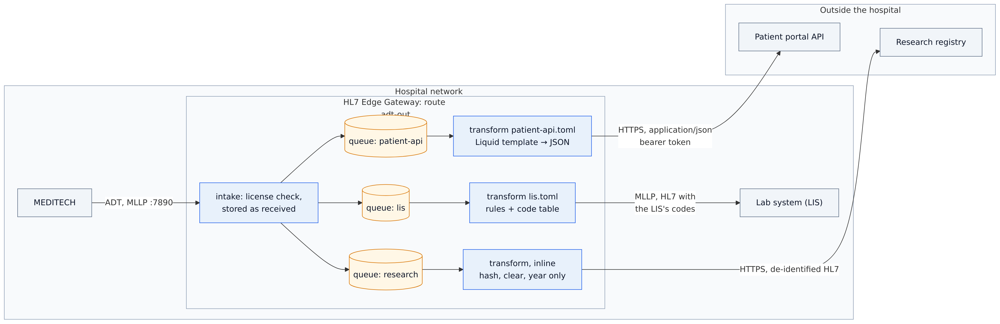
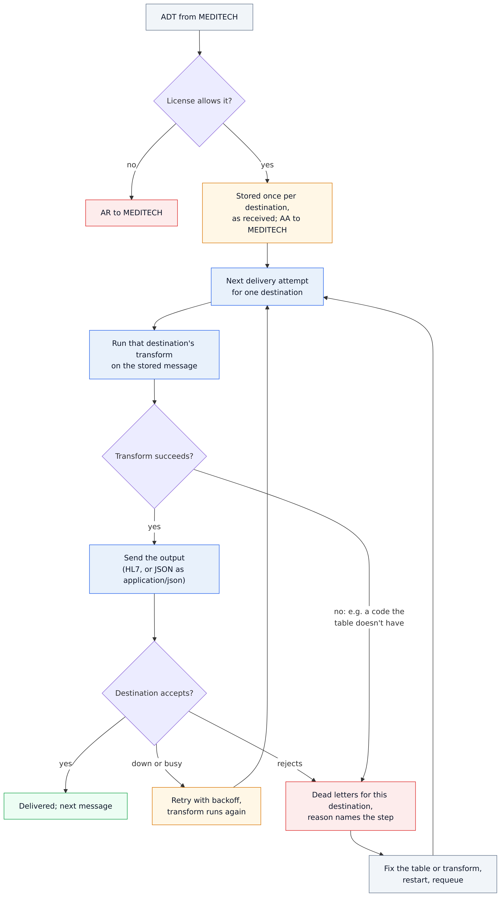
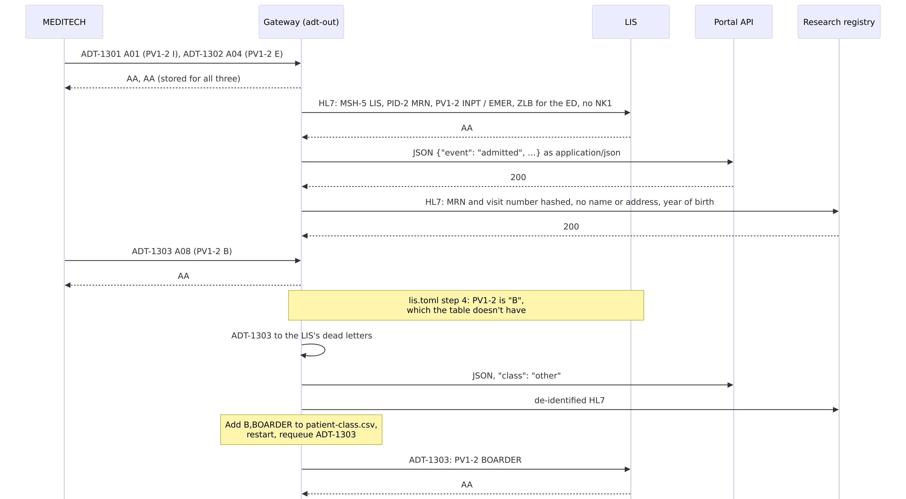

# 13 · One ADT feed, three shapes (transforms)

MEDITECH sends one ADT feed. Three systems want it, each in its own shape: the lab system (LIS) wants HL7 with its
own patient class codes, the MRN in PID-2, an ED flag and no next of kin; a patient portal wants JSON; a research
registry wants HL7 with nothing that identifies the patient. With HL7 Edge Gateway 0.6 that is **one route with
three destinations, each with a transform**.

```
                                ┌──────────────────────────┐ ──MLLP, transforms/lis.toml──────────▶ LIS             (HL7, its codes)
MEDITECH ──MLLP :7890─────────▶ │ route adt-out            │
                                │   stored as received,    │ ──HTTP, transforms/patient-api.toml──▶ portal API      (JSON)
                                │   one queue per system   │
                                └──────────────────────────┘ ──HTTP, inline transform───────────▶ research        (de-identified)
```

| Destination | Transform | What it gets |
|---|---|---|
| `lis` | [`transforms/lis.toml`](transforms/lis.toml): rules and a CSV code table | HL7: MSH-5/6 set to the LIS, the MRN copied to PID-2, a `ZLB` segment for emergency registrations, PV1-2 mapped through [`patient-class.csv`](transforms/tables/patient-class.csv) (a code the table doesn't have is an error), NK1 removed |
| `patient-api` | [`transforms/patient-api.toml`](transforms/patient-api.toml) with the Liquid template [`patient-api.liquid`](transforms/patient-api.liquid) | JSON, as `application/json`: the event, patient, visit and allergies |
| `research` | inline in [`gateway.toml`](gateway.toml) | HL7: the MRN and visit number replaced by salted SHA-256 hashes, name, address, phone and SSN cleared, year of birth only, NK1 removed |

The queue keeps each event **as MEDITECH sent it**; a transform runs at each delivery. So when the LIS's table is
missing a code, that event waits in the LIS's dead letters only, and once the table has the code, a requeue sends it
transformed with the new entry. The portal and the registry are never held up.

Step-by-step guide with screenshots: <https://docs.lambogenius.com/hl7-edge-gateway/example-one-message-three-shapes>

## Diagrams

**Architecture.** What runs where, and where each transform applies.



**Data flow.** What happens to a message at each step, including a transform that fails.



**Sequence.** One run of the sample, message by message.



The Mermaid sources are in [diagrams/](diagrams). After editing one, re-export the PNGs with
`../render-diagrams.sh 13-one-message-three-shapes`.

## Files

| File | What it is |
|---|---|
| `gateway.toml` | The gateway configuration: one route, three `[[route.destinations]]`, each with a `transform` |
| `transforms/` | The LIS's rules and code table, and the portal's Liquid template |
| `compose.yaml` | The gateway, the LIS, the portal API and research registry stand-ins, and the `send` and `tool` commands |
| `lis/receiver.py` | The LIS over MLLP: answers `AA` and prints each message as it arrived |
| `systems/app.py` | The portal API (`POST /patients`, JSON, bearer token) and the research registry (`POST /research`, HL7); `GET /received` shows what they have |
| `messages/` | Three ADT events: an inpatient A01 with allergies, an emergency A04, and an A08 for a boarder (`PV1-2` = `B`, a class the LIS's table doesn't have) |
| `.env.example` | License, admin token, the portal API's token and the research salt; copy it to `.env` |
| `demo.sh`, `demo.ps1` | Runs every step below and checks the result |

## Run it

You need Docker, the gateway image **0.6.0 or later**, and a license. See
[the prerequisites](../README.md#prerequisites).

```sh
cp .env.example .env          # then put your license in LAMBOGENIUS_LICENSE
docker compose up -d
```

The console is at <http://localhost:8080>: the route `adt-out` has a row for each destination with its transform.

**1. MEDITECH sends an inpatient admission and an emergency registration.**

```sh
docker compose run --rm send --to gateway:7890 /messages/adt-a01-inpatient.hl7 /messages/adt-a04-emergency.hl7
docker compose logs lis
curl http://localhost:8000/received
```

The LIS gets HL7 with `PV1|1|INPT|…` and `PV1|1|EMER|…`, the MRN in PID-2, `ZLB|ED|STAT` after the emergency
registration's PV1, and no NK1. The portal gets JSON (`"event": "admitted"`, `"class": "inpatient"`, the
allergies), sent as `application/json`. The registry gets HL7 whose PID-3.1 is a 64-character hash, with no name,
address or phone, and `1985` as the date of birth.

**2. A patient class the LIS doesn't have.**

```sh
docker compose run --rm send --to gateway:7890 /messages/adt-a08-boarder.hl7
```

MEDITECH gets `AA`: the event is stored for all three. The portal and the registry get it (`"class": "other"`,
from the template table's `"*"` entry). The LIS's transform has `missing = "fail"`, so ADT-1303 goes to the **LIS's**
dead letters with the reason `transform failed: step 4 (map PV1-2): PV1-2 is "B", which table patient_class doesn't
have`. In the console, select the `lis` row, then Dead letters, and open it: **As received** shows MEDITECH's
event, **As sent to lis** shows why it can't be sent.

**3. Add the code, restart, requeue.** Add a line to `transforms/tables/patient-class.csv`:

```
B,BOARDER
```

Then `docker compose restart gateway`, and requeue ADT-1303 from the LIS's dead letters in the console. The LIS gets
it with `PV1|1|BOARDER|…`: the dead letter held the original event, and the transform ran again with the new table.
(`demo.sh` puts the table back as it was when it finishes.)

**4. See what a transform does, without sending anything.** The `transform` command runs a destination's transform
on message files. With `--diff`, it shows the segments it changed:

```sh
docker compose run --rm tool transform -c /sample/gateway.toml --destination lis --diff /messages/adt-a04-emergency.hl7
```

```
transform OK: lis.toml: 5 rules

/messages/adt-a04-emergency.hl7  ADT-1302 ADT^A04
- MSH|^~\&|MEDITECH|GENERAL_HOSPITAL|HIS|GENERAL_HOSPITAL|20261021091500||ADT^A04^ADT_A01|ADT-1302|T|2.5.1
+ MSH|^~\&|MEDITECH|GENERAL_HOSPITAL|LIS|LAB|20261021091500||ADT^A04^ADT_A01|ADT-1302|T|2.5.1
  EVN|A04|20261021091500
- PID|1||200302^^^GENERAL_HOSPITAL^MR||LINDQVIST^ERIK||19921102|M|||7 Mill St^^Lakeside^ON^K0K 1A0||(555)010-4455||||||999-01-2302
+ PID|1|200302|200302^^^GENERAL_HOSPITAL^MR||LINDQVIST^ERIK||19921102|M|||7 Mill St^^Lakeside^ON^K0K 1A0||(555)010-4455||||||999-01-2302
- NK1|1|LINDQVIST^SARA|MTH||(555)010-4456
- PV1|1|E|ED^BAY3^1||||1234^HALE^SIMON|||MED|||||||||V5002|||||||||||||||||||||||||20261021091200
+ PV1|1|EMER|ED^BAY3^1||||1234^HALE^SIMON|||MED|||||||||V5002|||||||||||||||||||||||||20261021091200
+ ZLB|ED|STAT
```

`-t /sample/transforms/patient-api.toml` runs a transform file on its own, and prints the JSON. The console's
**Transform tester** does the same for pasted messages. It exits with 3 when a transform fails on a message, so a
build can test a transform change against sample messages.

`./demo.sh` (or `.\demo.ps1`) runs all of this and checks each result.

## Clean up

```sh
docker compose down -v
```

## Make it yours

- **Your codes.** Put each system's code tables in CSV files next to the transform; `"*"` (or a `*` line) is the
  value for codes the table doesn't list, and `missing = "fail"` makes an unknown code an error instead.
- **Your JSON.** Edit `patient-api.liquid`: `{{ msg | field: "PID-5.1" | json }}` reads any field path, and
  `segments` and `groups` loop over repeating segments. For XML, set `output = "xml"` and use the `xml` filter.
- **De-identification.** Keep `RESEARCH_SALT` secret and the same: the same MRN always hashes to the same value, so
  records still link up, but the MRN can't be read back. Review what else your messages carry (OBX notes, NTE,
  Z-segments) before you send them outside.
- The full transform syntax: <https://docs.lambogenius.com/hl7-edge-gateway/transforms>
