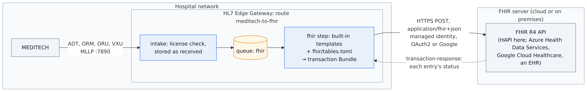
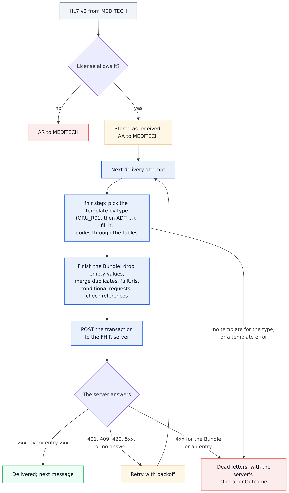
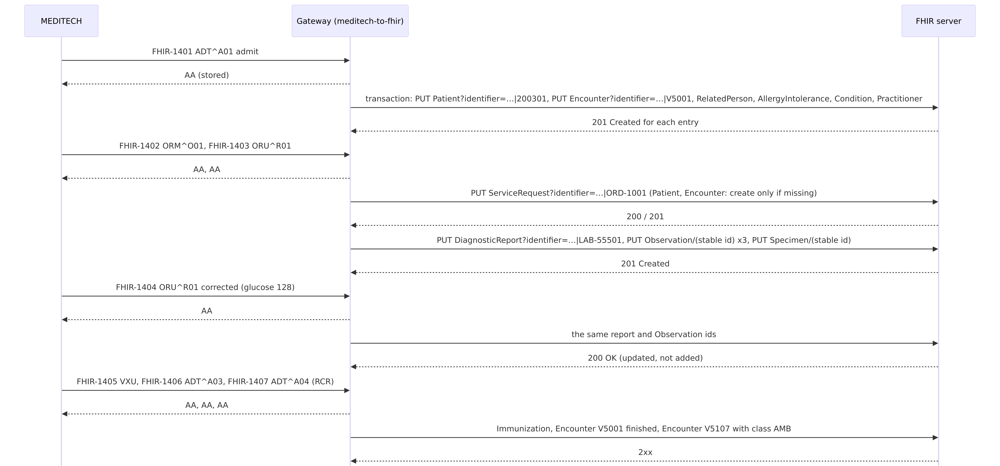

# 14 · MEDITECH to FHIR

MEDITECH speaks HL7 v2 over MLLP. The hospital's new systems (a FHIR server such as Azure Health Data Services or
the Google Cloud Healthcare API, a patient app, an analytics platform) want **FHIR R4**. With HL7 Edge Gateway 0.7,
a route's destination can be a FHIR server: each message becomes **one FHIR transaction**, made by the gateway's
built-in templates, with MEDITECH's own codes added in one small file. Here HAPI FHIR stands in for the server.

```
                                ┌───────────────────────────────┐
MEDITECH ──MLLP :7890─────────▶ │ route meditech-to-fhir        │ ──HTTP POST, a transaction Bundle──▶ FHIR R4 server
  ADT, ORM, ORU, VXU            │   stored as received          │      (application/fhir+json)         (HAPI here)
                                │   fhir step: built-in         │
                                │   templates + fhir/tables.toml│ ◀──each entry's status─────────────
                                └───────────────────────────────┘
```

| Message | Becomes |
|---|---|
| ADT^A01 admit | Patient, Encounter (in progress), RelatedPerson (NK1), AllergyIntolerance (AL1), Condition (DG1), Practitioner |
| ORM^O01 order | ServiceRequest |
| ORU^R01 results | DiagnosticReport, an Observation per OBX, Specimen; the order it fulfills |
| ORU^R01 corrected | the same DiagnosticReport and Observations, updated in place (`corrected`) |
| VXU^V04 | Immunization |
| ADT^A03 discharge | the same Encounter, now `finished` |
| ADT^A04, PV1-2 = `RCR` | a second Encounter, `AMB`: MEDITECH's code, from [`fhir/tables.toml`](fhir/tables.toml) |

Every message names the same patient, and the FHIR server ends up with **one** Patient: ADT keeps it up to date,
and orders, results and immunizations only create it if it isn't there yet. A resent or corrected result replaces
the Observations it made instead of adding more.

Step-by-step guide with screenshots: <https://docs.lambogenius.com/hl7-edge-gateway/example-meditech-to-fhir>

## Diagrams

**Architecture.** What runs where.



**Data flow.** What happens to a message, from MLLP to the FHIR server's answer.



**Sequence.** One run of the sample, message by message.



The Mermaid sources are in [diagrams/](diagrams). After editing one, re-export the PNGs with
`../render-diagrams.sh 14-meditech-to-fhir`.

## Files

| File | What it is |
|---|---|
| `gateway.toml` | The gateway configuration: one route, MLLP in, a `fhir` destination with a `fhir` transform step |
| `fhir/tables.toml` | MEDITECH's codes, added to the built-in FHIR code tables |
| `compose.yaml` | The gateway, HAPI FHIR, and the `send` and `tool` commands |
| `messages/` | Seven messages for one patient: admit, order, results, corrected results, a flu shot, discharge, a recurring visit |
| `.env.example` | License and admin token; copy it to `.env` |
| `demo.sh`, `demo.ps1` | Runs every step below and checks the result |

## Run it

You need Docker, the gateway image **0.7.0 or later**, and a license. See
[the prerequisites](../README.md#prerequisites). The messages are test messages (MSH-11 = `T`), so the free
Developer license works.

```sh
cp .env.example .env          # then put your license in LAMBOGENIUS_LICENSE
docker compose up -d          # HAPI FHIR takes about a minute to start the first time
```

The console is at <http://localhost:8080>: the route's destination shows `FHIR R4 http://fhir-server:8080/fhir` and
its transform `inline: fhir: templates fhir, transaction`. HAPI FHIR's own pages are at <http://localhost:8090>.

**1. MEDITECH admits a patient.**

```sh
docker compose run --rm send --to gateway:7890 /messages/1-adt-a01-admit.hl7
curl "http://localhost:8090/fhir/Patient?identifier=https://general-hospital.example/id/GENERAL_HOSPITAL|200301"
curl "http://localhost:8090/fhir/Encounter?identifier=https://general-hospital.example/id/GENERAL_HOSPITAL|V5001"
```

The server has the Patient (OKAFOR, female, born 1985-03-14, with the MRN and the health card number as
identifiers), an `in-progress` inpatient Encounter that started at `2026-10-21T08:25:00-04:00` (MEDITECH sends local
times; the gateway adds the offset of `America/Toronto` on that date), the spouse, the penicillin allergy, the
pneumonia diagnosis and the attending doctor.

**2. An order, then results.**

```sh
docker compose run --rm send --to gateway:7890 /messages/2-orm-o01-order.hl7 /messages/3-oru-r01-results.hl7
curl "http://localhost:8090/fhir/Observation?code=http://loinc.org|2345-7"
```

One ServiceRequest (ORD-1001), a `final` DiagnosticReport found by the lab's accession number, three Observations
(glucose 182 mg/dL, flagged high, with the lab's note), and the blood specimen. Still one Patient.

**3. The lab corrects the glucose.** The same report again, with OBX-11 = `C` and a new value:

```sh
docker compose run --rm send --to gateway:7890 /messages/4-oru-r01-corrected.hl7
```

Still three Observations: the glucose is now 128 mg/dL and `corrected`, and so is the report. Each Observation's id
comes from the report and the test, so the same result always lands on the same resource.

**4. A flu shot, 5. the discharge, 6. a recurring visit.**

```sh
docker compose run --rm send --to gateway:7890 /messages/5-vxu-v04-flu-shot.hl7 /messages/6-adt-a03-discharge.hl7 /messages/7-adt-a04-recurring.hl7
```

An Immunization (`completed`, lot FL4417, left deltoid); the visit V5001 `finished` at 10:45 on October 23; and a
dialysis visit V5107 whose class is `AMB`. MEDITECH sent `RCR` in PV1-2, a code HL7's table doesn't have, and
[`fhir/tables.toml`](fhir/tables.toml) adds it:

```toml
[patient_class]
RCR = "AMB"
SDC = "AMB"
```

**7. See the Bundle a message makes, without sending it.**

```sh
docker compose run --rm tool transform -c /sample/gateway.toml --destination fhir /messages/5-vxu-v04-flu-shot.hl7
```

It prints the transaction Bundle; the console's **Transform tester** does the same for pasted messages.

`./demo.sh` (or `.\demo.ps1`) runs all of this and checks each result.

## When the server says no

If the FHIR server refuses an entry (a 4xx, such as a code it doesn't accept), the message goes to the route's dead
letters with the server's reason, and MEDITECH's feed keeps flowing. If the server is down or busy (5xx, 429, no
answer), the gateway keeps the message and retries, in order.

## Clean up

```sh
docker compose down -v
```

## Make it yours

- **Your FHIR server.** Change `base_url`, and add `auth`: `{ type = "managed_identity" }` on Azure,
  `{ type = "google", key_file = "…" }` on Google Cloud, or OAuth2 client credentials (SMART backend services).
- **Your identifiers.** Set `identifier_system_base` to your organization's namespace; MRNs become
  `<base><assigning authority>|<MRN>`. Or map assigning authorities to systems in an `identifier_systems` table.
- **Your codes.** Add MEDITECH's local codes to `fhir/tables.toml`. To change more, export the built-in templates
  and tables with `docker compose run --rm -v ./fhir-export:/export tool fhir-templates /export`, copy the
  templates you want to change into `fhir/` and edit them; the rest stay built in.
- The full guide: <https://docs.lambogenius.com/hl7-edge-gateway/fhir>
