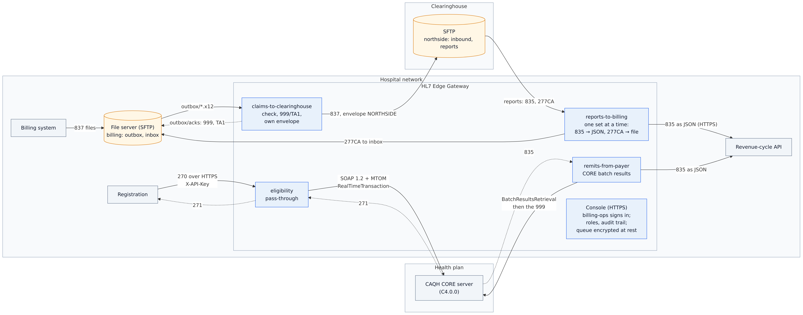
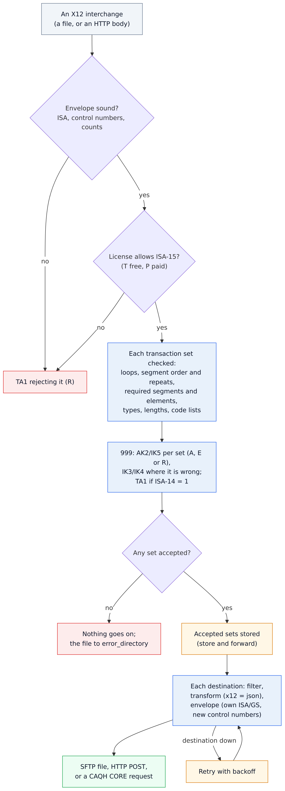
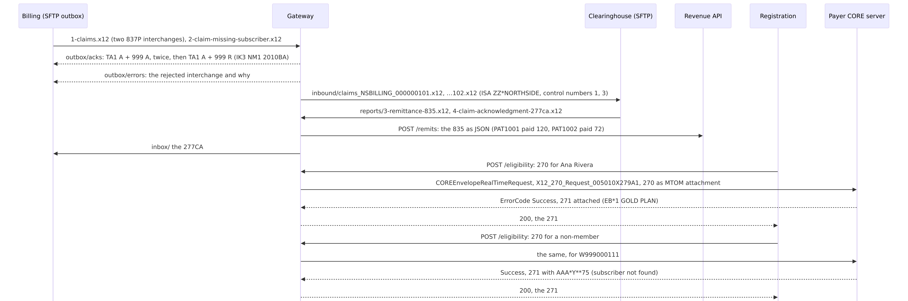

# 15 · Claims, remittances and eligibility (X12)

A clinic's billing system makes **837 claims**; the clearinghouse wants them from the clinic, checked, in the
clinic's own envelope, and sends **835 remittances** and **277CA claim acknowledgments** back. Registration wants to
know, while the patient is at the desk, whether the health plan covers them: a **270** to the payer's **CAQH CORE**
server, a **271** back. The payer also has remittances of its own waiting on that server, for the gateway to pick
up. All of it runs through X12 routes, with the same queues, retries and console as HL7. Claims and remittances are
PHI, so stored messages are encrypted, the console is HTTPS with a sign-in for the billing office's operator, and
everything done in it is in the audit trail (HL7 Edge Gateway 0.9).

```
Billing ──837 files (SFTP outbox)──▶ claims-to-clearinghouse ──837, envelope NORTHSIDE──▶ Clearinghouse (SFTP inbound)
        ◀──999 + TA1 (outbox/acks)──   checks every interchange
                                                                    ┌──835 as JSON──▶ Revenue-cycle API
Clearinghouse ──835, 277CA (SFTP reports)──▶ reports-to-billing ────┤
                                                                    └──277CA file───▶ Billing (SFTP inbox)
Registration ──270 (HTTPS, X-API-Key)──▶ eligibility ──CAQH CORE C4.0.0 (SOAP + MTOM)──▶ Payer
             ◀──────────271────────────              ◀────────────271──────────────────
Revenue-cycle API ◀──835 as JSON── remits-from-payer ──batch results retrieval, then the 999──▶ Payer
```

| Route | What it shows |
|---|---|
| `claims-to-clearinghouse` | An SFTP source reading X12 files; every interchange checked and answered with a 999 (and a TA1, as ISA-14 asks) in `ack_directory`; a rejected interchange to `error_directory` with the reason; accepted claims sent on under the gateway's own ISA/GS (`envelope`) |
| `reports-to-billing` | `split = "transaction"`: each set on its own, so `filter = { transaction_set = … }` sends 835s to the revenue API as JSON (`x12 = "json"`) and 277CAs to billing |
| `eligibility` | Pass-through to a `caqh_core` destination: the payer's 271 straight back to registration |
| `remits-from-payer` | A `caqh_core` source: asks the payer's CORE server for 835s waiting there every `poll_interval`, sends each to the revenue API as JSON, and sends the payer the gateway's 999 for it |

And around them: `[store] encryption` (AES-256-GCM, the key from `HL7EDGE_STORE_KEY`), the console over HTTPS with
the local user `billing-ops` (an **operator**: pause, retry and requeue, but no message contents and no audit trail),
automatic logoff after 15 minutes, and the audit trail.

The people, organizations and IDs in the files are made up. Step-by-step guide with screenshots:
<https://docs.lambogenius.com/hl7-edge-gateway/example-claims-remits-eligibility>

## Diagrams

**Architecture.** What runs where.



**Data flow.** What happens to an interchange, from arrival to its destinations.



**Sequence.** One run of the sample, file by file.



The Mermaid sources are in [diagrams/](diagrams). After editing one, re-export the PNGs with
`../render-diagrams.sh 15-claims-remits-eligibility`.

## Files

| File | What it is |
|---|---|
| `gateway.toml` | The gateway configuration: four X12 routes, the console user, store encryption |
| `compose.yaml` | The gateway, one SFTP server standing in for the hospital's file server and the clearinghouse's, the revenue API, the payer's CORE server, and the `tool` command |
| `files/` | Two claims, a claim without its subscriber, a remittance (835), a claim acknowledgment (277CA), two eligibility requests (270) |
| `payer/core_payer.py` | Stand-in for the payer's CAQH CORE server: answers each 270 with a 271 (covered, or subscriber not found), and hands out the remittances in `payer/remits/` |
| `revenue/revenue_api.py` | Stand-in for the revenue-cycle API: takes remittances as JSON |
| `sftp/` | Makes the SFTP server's host keys, the gateway's key and the console's certificate, and lets the key in |
| `.env.example` | License, admin token, registration's API key, SFTP password, store key, billing-ops's password hash; copy it to `.env` |
| `demo.sh`, `demo.ps1` | Runs every step below and checks the result |

## Run it

You need Docker, the gateway image **0.9.2 or later** (0.9.0 works, but its health check reports the TLS console as
unhealthy), and a license. See [the prerequisites](../README.md#prerequisites). The files are test interchanges
(ISA-15 = `T`), so the free Developer license works.

```sh
cp .env.example .env          # then put your license in LAMBOGENIUS_LICENSE
docker run --rm lambogenius/hl7-edge-gateway:0.9.2 generate-key          # into HL7EDGE_STORE_KEY
docker run --rm -it lambogenius/hl7-edge-gateway:0.9.2 hash-password     # into BILLING_OPS_PASSWORD_HASH, in '…'
docker compose up -d
```

The console is at <https://localhost:8080>. Its certificate is self-signed, made by the `keys` container, so the
browser warns once. Sign in as `billing-ops` with the password you hashed: four routes, each marked **X12**, with
pause and retry but no message contents. To look at the SFTP folders yourself, sign in to `localhost:2222` as
`billing` or `northside` with `SFTP_PASSWORD`.

**0. Check the claim files first.** The `x12` command checks files as the gateway will, and exits 3 when something
is rejected:

```sh
docker compose run --rm tool x12 /files/1-claims.x12 /files/2-claim-missing-subscriber.x12
```

```
/files/2-claim-missing-subscriber.x12: 837P from NSBILLING to ACMECLEAR (ISA-13 000000103, ISA-15 T)
  rejected: 837P 0001: N3 (2000B) at 13: unexpected segment (and 3 more)
  set 0001 837P 005010X222A1: rejected
    …
    NM1 (2010BA) at 16: required segment missing
```

Add `--ack` to see the 999 the gateway would answer, and `--json` to see the JSON a transform makes.

**1. Billing drops the claims.** Put `files/1-claims.x12` (two interchanges back to back) and
`files/2-claim-missing-subscriber.x12` in the `billing` account's `outbox`. Within a few seconds:

- `outbox/acks/1-claims.x12.ack.x12` has a TA1 (`A`) and a 999 accepting each interchange;
- `outbox/acks/2-claim-missing-subscriber.x12.ack.x12` has a 999 that rejects the claim, with
  `IK3*NM1*16*2010BA*3`: the subscriber's name (loop 2010BA) is missing;
- `outbox/errors/` has the rejected interchange and a `.txt` with the reason; both files are in `outbox/done`.

**2. The clearinghouse gets the accepted claims.** The `northside` account's `inbound` folder has
`claims_NSBILLING_000000101.x12` and `…102.x12`. Each starts
`ISA*00*          *00*          *ZZ*NORTHSIDE      *ZZ*ACMECLEAR      *`: the billing system's own ID (NSBILLING)
became the clinic's, with control numbers the gateway keeps and never repeats.

**3. Remittance and acknowledgment come back.** Put `files/3-remittance-835.x12` and
`files/4-claim-acknowledgment-277ca.x12` in `northside`'s `reports`. The revenue API logs the 835, which it got as
JSON:

```sh
docker compose logs revenue
```

```
revenue: EFT20261030 PAT1001 billed 150 paid 120 patient owes 30
revenue: EFT20261030 PAT1002 billed 95 paid 72 patient owes 0
```

and the 277CA is in `billing`'s `inbox`.

**4. Eligibility, in real time.**

```sh
curl -H "X-API-Key: <REGISTRATION_API_KEY>" -H "Content-Type: application/edi-x12" \
  --data-binary @files/5-eligibility-270.x12 http://localhost:8081/eligibility
```

The answer is the payer's 271: `EB*1*IND*30**GOLD PLAN~`, a $500 deductible and a $25 copay. For
`files/6-eligibility-270-not-covered.x12` it is `AAA*Y**75*C~`, subscriber not found. The gateway sent each 270 to
the payer's CORE server as a SOAP 1.2 `COREEnvelopeRealTimeRequest` with the 270 as an MTOM attachment, and
`hl7edge_core_requests_total` on <https://localhost:8080/metrics> counts the answers by ErrorCode. Without the
API key the gateway answers 401.

**5. Remittances from the payer.** Every 10 seconds the `remits-from-payer` route asks the payer's CORE server for
835s (`COREEnvelopeBatchResultsRetrievalRequest`, PayloadType `X12_835_Request_005010X221A1`). The payer has one
waiting, in `payer/remits/`:

```
payer: remittance 835-acme-007501.x12 handed out
payer: 999 received for a remittance: AK9*A*1*1*1
revenue: EFT20261106 PAT1003 billed 200 paid 160 patient owes 40
```

The gateway stored it, sent the payer its 999 (as CORE asks), and delivered it to the revenue API as JSON; the next
poll gets `X12_005010_Response_NoBatchResultsFile`. `hl7edge_core_retrievals_total` counts each.

**6. The console and the audit trail.** Signed in as `billing-ops`, pause and resume a route: it works. Opening a
message doesn't (no `view_payload`), and neither does the audit trail (auditors and admins only); both refusals are
in the trail. With the admin token:

```sh
curl -k -H "Authorization: Bearer <HL7EDGE_ADMIN_TOKEN>" "https://localhost:8080/api/audit?limit=10"
```

lists the sign-in, the pause and resume, the refusals, and the gateway's start, newest first, each with who, from
where and the outcome. The gateway's log says `stored messages are encrypted`: what waits in the queue volume is
ciphertext.

`./demo.sh` (or `.\demo.ps1`) runs all of this and checks each result. Set `BILLING_OPS_PASSWORD` in `.env` too for
it to sign in as `billing-ops`.

## Clean up

```sh
docker compose down -v
```

## Make it yours

- **Your clearinghouse.** Point the SFTP source and destination at your file server and the clearinghouse's, with
  the host key fingerprints they give you (`hl7-edge-gateway host-key --to <host>`), and set the `envelope` IDs to
  the ones in your trading partner agreement.
- **Your payer.** Set `url`, `sender_id` and `receiver_id` from the payer's connectivity guide, and the client
  certificate (`tls`) and OAuth 2.0 client (`auth`) they enroll you with; the lines are in `gateway.toml`. For a
  server on CORE 2.2.0, set `rule_version = "2.2.0"` with `username` and `password`.
- **Your payer's remittances.** Set `retrieve` to the PayloadTypes the payer's connectivity guide lists (835s,
  277CAs, 999s for your batches) and `poll_interval` to what they allow.
- **Your people.** Single sign-on instead of local users: the `[admin.oidc]` lines in `gateway.toml`, with roles
  from your identity provider. Keep the store key and the password hashes in your secret store.
- **Production.** Production interchanges (ISA-15 = `P`) need the paid license.
- The guides: <https://docs.lambogenius.com/hl7-edge-gateway/x12>,
  <https://docs.lambogenius.com/hl7-edge-gateway/caqh-core> and
  <https://docs.lambogenius.com/hl7-edge-gateway/security>
